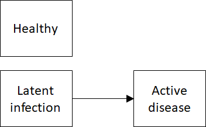

<!-- README.md is generated from README.Rmd. Please edit that file -->

# EvidSynthTB: Bayesian Evidence Synthesis of LTBI and TB Progression Data

<!-- badges: start -->

[](https://lifecycle.r-lib.org/articles/stages.html#experimental)
<!-- badges: end -->

The goal of `EvidSynthTB` is to use Bayesian Multi-Parameter Evidence
Synthesis (MPES) in CmdStan to jointly or modularly estimate latent
tuberculosis infection (LTBI) prevalence ($\pi$), imperfect diagnostic
test sensitivity and specificity ($\text{sens}, \text{spec}$), and
active TB progression hazard rates ($\lambda, \text{shape}$) via
parametric mixture cure models.

## Model Structure

The framework links two core epidemiological modules:

1.  **Starting state occupancy & imperfect diagnostic testing ($M_1$):**
    True baseline LTBI status $Z_i \sim \text{Bernoulli}(\pi_i)$ is
    observed only through $K \ge 1$ imperfect diagnostic tests (e.g.,
    IGRA, TST) with sensitivity $\text{sens}_k$ and specificity
    $\text{spec}_k$:
    $$p_{\text{pos}, i, k} = \pi_i \, \text{sens}_k + (1 - \pi_i)(1 - \text{spec}_k)$$
2.  **Active TB progression mixture cure model ($M_2$):** Only truly
    infected individuals ($Z_i = 1$, uncured fraction $\pi_i$, or
    positive predictive value $\text{PPV}_i$ in a test-positive
    follow-up cohort) are at risk of progressing to active TB with
    uncured survival $S_u(t)$ and density $f_u(t)$ (`"gompertz"`,
    `"weibull"`, or `"exponential"`):
    $$L_{\text{surv}, i} = \left[ \tilde{\pi}_i f_u(t_i) \right]^{d_i} \left[ (1 - \tilde{\pi}_i) + \tilde{\pi}_i S_u(t_i) \right]^{1 - d_i}$$

<figure>

<figcaption aria-hidden="true">Two-module LTBI and active TB progression
model flow diagram</figcaption>
</figure>

### Six Synthesis & Modular Feedback Strategies

`evidsynth_fit()` and `compare_evidsynth()` support six ways of sharing
or cutting information between the LTBI diagnostic module and the active
TB progression module:

- **`"joint"`**: Full joint likelihood
  ($\pi_{\text{diag}} = \pi_{\text{surv}}$), supporting both
  `"population"` coupling and individual-level `"latent_class"`
  marginalization over $Z_i \in \{0, 1\}$.
- **`"cut"`**: True two-stage Bayesian cut model (Plummer 2015). Stage 1
  fits `ltbi_module.stan` on diagnostic/survey data alone; Stage 2
  propagates Stage 1 posterior draws into the progression mixture cure
  model while blocking feedback from survival data back into LTBI
  prevalence.
- **`"independent"`**: Separate unlinked prevalence parameters
  $\pi_{\text{diag}}$ and $\pi_{\text{surv}}$.
- **`"melding"`**: Two-stage normal portal plug-in
  ($\hat{\mu}, \hat{\sigma}$ on $\text{logit}(\pi)$).
- **`"elastic"`**: Hierarchical coupling
  $\text{logit}(\pi_{\text{surv}}) \sim \mathcal{N}(\text{logit}(\pi_{\text{diag}}), \tau^2)$
  with tuneable `tau_couple`.
- **`"tempered"`**: Power-likelihood tempering weighting the survival
  contribution by `w_temper` $\in [0, 1]$.

## Examples

### 1. Simulated Conflict Scenario (Imperfect Tests + Cut vs. Joint Models)

``` r
library(EvidSynthTB)

# Simulate survey with true LTBI prevalence = 0.25, but a progression cohort
# with selection bias (true LTBI prevalence = 0.65) and imperfect IGRA test
sim <- create_fake_data(
  N_surv = 400,
  n_survey = 1500,
  p_ltbi = 0.25,
  p_ltbi_surv = 0.65,
  sens = 0.85,
  spec = 0.95,
  surv_dist = "gompertz",
  shape = 0.1,
  rate = 0.12,
  seed = 42
)

comp <- compare_evidsynth(
  prevalence_data = sim$prevalence_data,
  progression_data = sim$progression_data[, c("t", "d")],
  models = c("joint", "cut", "independent", "elastic", "tempered"),
  imperfect_test = TRUE
)

comp$summary_table
plot_model_comparison(comp, truth = c(prev_diag = 0.25, lambda = 0.12, shape = 0.1))
plot_survival_comparison(comp)
```

### 2. Reconstructed Abubakar (2018) UK PREDICT-TB Data

``` r
abub <- load_abubakar_2018()

fit_abub <- evidsynth_fit(
  prevalence_data = abub$prevalence_data,
  progression_data = abub$progression_data,
  model = "cut",
  imperfect_test = TRUE
)

fit_abub$summary
plot_progression(fit_abub)
```

### 3. Individual-Level Linked PREDICT-TB Migrant Cohort

``` r
migrant <- load_predict_migrant()

fit_migrant <- evidsynth_fit(
  prevalence_data = migrant$prevalence_data,
  progression_data = migrant$progression_data,
  model = "joint",
  coupling = "latent_class",
  imperfect_test = TRUE,
  covariates = "age_z"
)

fit_migrant$summary
```
