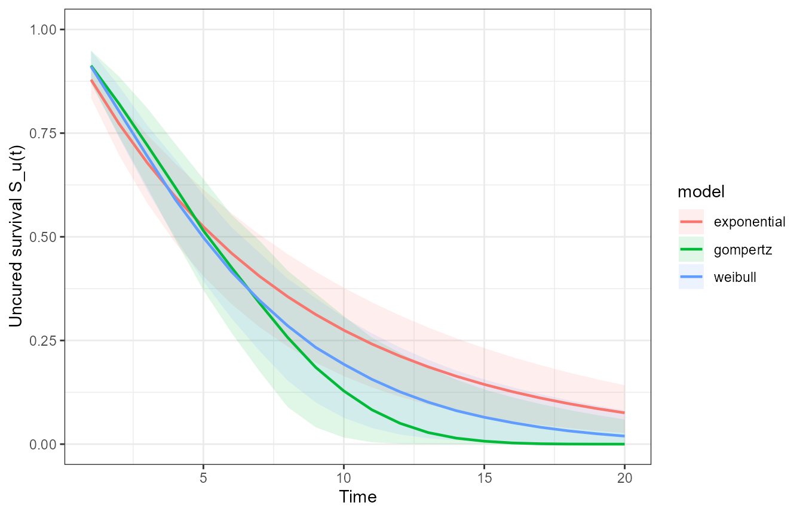

# 2. Imperfect Diagnostic Tests, Latent-Class Coupling, and Subgroup Cohorts

## Overview

LTBI diagnostic tests—such as interferon-gamma release assays (IGRA:
QuantiFERON, T-SPOT.TB) and the tuberculin skin test (TST)—have
imperfect sensitivity and specificity. Furthermore, clinical cohorts
differ in how diagnostic test results and active TB progression
follow-up are structured:

1.  **Population-Level vs. Individual-Level Latent-Class Coupling
    (`coupling`):** Whether we only link population-level prevalence
    \\\pi\\ across modules, or jointly marginalize over each
    individual’s latent infection status \\Z_i \in \\0, 1\\\\ across
    their baseline test result(s) \\\mathbf{x}\_i\\ and progression
    outcome \\(t_i, d_i)\\.
2.  **Single vs. Multiple Diagnostic Tests (\\K \ge 1\\):** Combining
    \\K = 2\\ tests (e.g., IGRA + TST) on the same individuals provides
    conditional latent-class information about sensitivity, specificity,
    and prevalence.
3.  **All-Comers vs. Test-Positive Follow-Up (`cohort_type`):** When
    only test-positive individuals (\\X\_{i,1} = 1\\) are followed for
    progression, false positives cannot progress to active TB, so the
    uncured fraction is the **Positive Predictive Value
    (\\\text{PPV}\\)** rather than the population prevalence \\\pi\\.
4.  **Covariates & Parametric Survival Families (`covariates`,
    `surv_dist`):** Adjusting prevalence by baseline risk factors and
    comparing Gompertz, Weibull, and Exponential progression hazards.

------------------------------------------------------------------------

## Mathematical Formulation

### 1. Imperfect Diagnostic Tests (\\K \ge 1\\) and Covariates

Let \\Z_i \in \\0, 1\\\\ denote true baseline LTBI status for individual
\\i\\, with covariate-adjusted prevalence:

\\ P(Z_i = 1) = \pi_i = \text{logit}^{-1}(\eta_i), \qquad \eta_i =
\alpha + \mathbf{x}\_{\text{cov}, i}^\top \boldsymbol{\beta}. \\

Suppose individual \\i\\ undergoes \\K \ge 1\\ diagnostic tests
\\\mathbf{X}\_i = (X\_{i,1}, \dots, X\_{i,K})\\ with sensitivities
\\\text{sens}\_k = P(X\_{i,k} = 1 \mid Z_i = 1)\\ and specificities
\\\text{spec}\_k = P(X\_{i,k} = 0 \mid Z_i = 0)\\. Conditional on
\\Z_i\\, the test likelihood is:

\\ P(\mathbf{X}\_i = \mathbf{x}\_i \mid Z_i = 1) = \prod\_{k=1}^{K}
\text{sens}\_k^{x\_{i,k}} (1 - \text{sens}\_k)^{1 - x\_{i,k}}, \qquad
P(\mathbf{X}\_i = \mathbf{x}\_i \mid Z_i = 0) = \prod\_{k=1}^{K} (1 -
\text{spec}\_k)^{x\_{i,k}} \text{spec}\_k^{1 - x\_{i,k}}. \\

Marginalizing over \\Z_i \in \\0, 1\\\\ gives the marginal test
likelihood for individual \\i\\:

\\ P(\mathbf{X}\_i = \mathbf{x}\_i) = (1 - \pi_i) P(\mathbf{X}\_i =
\mathbf{x}\_i \mid Z_i = 0) + \pi_i P(\mathbf{X}\_i = \mathbf{x}\_i \mid
Z_i = 1). \\

------------------------------------------------------------------------

### 2. Population Coupling vs. Individual Latent-Class Coupling

When a linked cohort observes **both** diagnostic test results
\\\mathbf{x}\_i\\ and progression follow-up \\(t_i, d_i)\\ on the same
individuals \\i = 1, \dots, N\_{\text{surv}}\\, `EvidSynthTB` supports
two coupling mechanisms:

#### A. Population-Level Modular Coupling (`coupling = "population"`)

Treats the diagnostic test results and survival times as two separate
modular likelihoods that share the population prevalence parameter
\\\pi_i\\, marginalizing over \\Z_i\\ independently in each module:

\\ L_i^{\text{pop}}(\mathbf{x}\_i, t_i, d_i) = \Big\[ (1 -
\pi\_{\text{diag}, i}) P(\mathbf{x}\_i \mid Z_i = 0) +
\pi\_{\text{diag}, i} P(\mathbf{x}\_i \mid Z_i = 1) \Big\] \times \Big\[
\pi\_{\text{surv}, i} f_u(t_i) \Big\]^{d_i} \Big\[ (1 -
\pi\_{\text{surv}, i}) + \pi\_{\text{surv}, i} S_u(t_i) \Big\]^{1 -
d_i}. \\

#### B. Individual-Level Latent-Class Coupling (`coupling = "latent_class"`)

Recognizes that the **same** latent infection state \\Z_i \in \\0, 1\\\\
governs both individual \\i\\’s baseline test results \\\mathbf{x}\_i\\
and their ability to progress to active TB \\(t_i, d_i)\\. Marginalizing
\\Z_i\\ over the joint outcome \\(\mathbf{X}\_i, T_i, d_i)\\ yields:

\\ L_i^{\text{LC}}(\mathbf{x}\_i, t_i, d_i) = \begin{cases} \pi_i \\
P(\mathbf{x}\_i \mid Z_i = 1) \\ f_u(t_i) & \text{if } d_i = 1 \text{
(active TB progression confirms } Z_i = 1\text{)}, \\\[6pt\] (1 - \pi_i)
\\ P(\mathbf{x}\_i \mid Z_i = 0) + \pi_i \\ P(\mathbf{x}\_i \mid Z_i
= 1) \\ S_u(t_i) & \text{if } d_i = 0 \text{ (right-censored at }
t_i\text{)}. \end{cases} \\

Notice two critical properties of \\L_i^{\text{LC}}\\: 1. Every
individual who progresses to active TB (\\d_i = 1\\) is known with
certainty to have been truly infected (\\Z_i = 1\\), so their baseline
test result directly informs test sensitivity via \\P(\mathbf{x}\_i \mid
Z_i = 1)\\. 2. Under the **Cut** model (`model = "cut"`, Stage 2) with
`"latent_class"` coupling, Stage 2 conditions each censored person’s
survival mixture on their individual test-updated posterior infection
probability \\\text{PPV}(\mathbf{x}\_i) = P(Z_i = 1 \mid
\mathbf{x}\_i)\\:

\\ \text{PPV}(\mathbf{x}\_i) = P(Z_i = 1 \mid \mathbf{x}\_i) =
\frac{\pi_i \\ P(\mathbf{x}\_i \mid Z_i = 1)}{(1 - \pi_i) \\
P(\mathbf{x}\_i \mid Z_i = 0) + \pi_i \\ P(\mathbf{x}\_i \mid Z_i = 1)}.
\\

------------------------------------------------------------------------

### 3. Test-Positive Subgroup Follow-Up (`cohort_type = "pos_only"`)

In many clinical studies, only individuals who test positive on baseline
screening (\\X\_{i,1} = 1\\) are enrolled into longitudinal follow-up.
Because test specificity \\\text{spec}\_1 \< 1\\, a fraction of
test-positive individuals are false positives (\\Z_i = 0, X\_{i,1} =
1\\) who can never progress to active TB. By Bayes’ rule, the effective
uncured fraction \\\tilde{\pi}\_i\\ among test-positives is the
**Positive Predictive Value**:

\\ \tilde{\pi}\_i = \text{PPV}\_i = P(Z_i = 1 \mid X\_{i,1} = 1) =
\frac{\pi_i \\ \text{sens}\_1}{\pi_i \\ \text{sens}\_1 + (1 - \pi_i)(1 -
\text{spec}\_1)}, \\

and the survival mixture cure likelihood for the test-positive cohort
becomes:

\\ L\_{\text{pos-only}, i}(t_i, d_i) = \left\[ \text{PPV}\_i \\ f_u(t_i)
\right\]^{d_i} \left\[ (1 - \text{PPV}\_i) + \text{PPV}\_i \\ S_u(t_i)
\right\]^{1 - d_i}. \\

------------------------------------------------------------------------

### 4. Parametric Uncured Survival Families (`surv_dist`)

`EvidSynthTB` supports three parametric families for the uncured
progression time distribution:

| Distribution (`surv_dist`) | Hazard \\h_u(t)\\ | Uncured Survival \\S_u(t)\\ | Parameters |
|:---|:---|:---|:---|
| **`"gompertz"`** | \\h_u(t) = \lambda \exp(\gamma t)\\ | \\S_u(t) = \exp\\\left(-\frac{\lambda}{\gamma}\left(e^{\gamma t} - 1\right)\right)\\ | Rate \\\lambda \> 0\\, shape \\\gamma \in \mathbb{R}\\ |
| **`"weibull"`** | \\h_u(t) = \lambda \gamma t^{\gamma - 1}\\ | \\S_u(t) = \exp\\\left(-\lambda t^{\gamma}\right)\\ | Rate \\\lambda \> 0\\, shape \\\gamma \> 0\\ |
| **`"exponential"`** | \\h_u(t) = \lambda\\ | \\S_u(t) = \exp(-\lambda t)\\ | Rate \\\lambda \> 0\\ (\\\gamma = 0\\) |

------------------------------------------------------------------------

## Worked Examples

``` r

library(EvidSynthTB)
library(dplyr)
library(ggplot2)
```

### Example 1: Population vs. Latent-Class Coupling with Dual Tests (\\K = 2\\)

``` r

sim_k2 <- create_fake_data(
  N_surv = 300,
  n_survey = 1000,
  p_ltbi = 0.30,
  sens = c(0.85, 0.78),
  spec = c(0.95, 0.90),
  surv_dist = "gompertz",
  shape = 0.15,
  rate = 0.10,
  seed = 301
)

fit_pop <- evidsynth_fit(
  prevalence_data = sim_k2$prevalence_data,
  progression_data = sim_k2$progression_data[, c("t", "d", "x1")],
  model = "joint",
  coupling = "population",
  imperfect_test = TRUE,
  chains = 1,
  n_iter = 400,
  n_burnin = 200,
  seed = 301
)

fit_lc_k2 <- evidsynth_fit(
  prevalence_data = sim_k2$prevalence_data,
  progression_data = sim_k2$progression_data[, c("t", "d", "x1", "x2")],
  model = "joint",
  coupling = "latent_class",
  imperfect_test = TRUE,
  chains = 1,
  n_iter = 400,
  n_burnin = 200,
  seed = 301
)

comp_lc <- structure(
  list(
    fits = list(population_1test = fit_pop, latent_class_2tests = fit_lc_k2),
    summary_table = bind_rows(
      mutate(fit_pop$summary, model = "population_1test"),
      mutate(fit_lc_k2$summary, model = "latent_class_2tests")
    )
  ),
  class = "evidsynth_comparison"
)

knitr::kable(
  evaluate_comparison(comp_lc, truth = sim_k2$truth)$parameter_metrics,
  digits = 3
)
```

| model | variable | truth | post_mean | post_median | post_sd | bias | rmse | cov_95 | width_95 |
|:---|:---|---:|---:|---:|---:|---:|---:|:---|---:|
| population_1test | prev_diag | 0.300 | 0.295 | 0.296 | 0.028 | -0.005 | 0.028 | TRUE | 0.104 |
| population_1test | prev_cf | 0.300 | 0.295 | 0.296 | 0.028 | -0.005 | 0.028 | TRUE | 0.104 |
| population_1test | ppv_cf | 0.879 | 0.881 | 0.890 | 0.061 | 0.001 | 0.061 | TRUE | 0.211 |
| population_1test | lambda | 0.100 | 0.088 | 0.084 | 0.023 | -0.012 | 0.026 | TRUE | 0.087 |
| population_1test | shape | 0.150 | 0.157 | 0.159 | 0.072 | 0.007 | 0.072 | TRUE | 0.269 |
| population_1test | sens\[1\] | 0.850 | 0.847 | 0.844 | 0.039 | -0.003 | 0.039 | TRUE | 0.166 |
| population_1test | spec\[1\] | 0.950 | 0.953 | 0.956 | 0.022 | 0.003 | 0.023 | TRUE | 0.080 |
| latent_class_2tests | prev_diag | 0.300 | 0.305 | 0.306 | 0.022 | 0.005 | 0.023 | TRUE | 0.084 |
| latent_class_2tests | prev_cf | 0.300 | 0.305 | 0.306 | 0.022 | 0.005 | 0.023 | TRUE | 0.084 |
| latent_class_2tests | ppv_cf | 0.879 | 0.881 | 0.888 | 0.040 | 0.001 | 0.039 | TRUE | 0.153 |
| latent_class_2tests | lambda | 0.100 | 0.093 | 0.090 | 0.024 | -0.007 | 0.025 | TRUE | 0.107 |
| latent_class_2tests | shape | 0.150 | 0.148 | 0.148 | 0.059 | -0.002 | 0.059 | TRUE | 0.238 |
| latent_class_2tests | sens\[1\] | 0.850 | 0.822 | 0.824 | 0.030 | -0.028 | 0.041 | TRUE | 0.116 |
| latent_class_2tests | spec\[1\] | 0.950 | 0.951 | 0.954 | 0.015 | 0.001 | 0.015 | TRUE | 0.058 |

### Example 2: Test-Positive Follow-Up Cohort (`cohort_type = "pos_only"`)

``` r

sim_pos <- create_fake_data(
  N_surv = 500,
  n_survey = 1200,
  p_ltbi = 0.30,
  sens = 0.85,
  spec = 0.92,
  surv_dist = "gompertz",
  shape = 0.10,
  rate = 0.12,
  cohort_type = "pos_only",
  seed = 302
)

# True baseline prevalence is 0.30, whereas true PPV among test-positives is ~0.82
c(true_p_ltbi = sim_pos$truth$p_ltbi, true_ppv = round(sim_pos$truth$ppv_surv, 3))
#> true_p_ltbi    true_ppv 
#>        0.30        0.82

comp_pos <- compare_evidsynth(
  prevalence_data = sim_pos$prevalence_data,
  progression_data = sim_pos$progression_data[, c("t", "d")],
  models = c("joint", "cut"),
  cohort_type = "pos_only",
  imperfect_test = TRUE,
  chains = 1,
  n_iter = 400,
  n_burnin = 200,
  n_cut_subsamples = 10,
  seed = 302
)

knitr::kable(
  evaluate_comparison(comp_pos, truth = sim_pos$truth)$parameter_metrics,
  digits = 3
)
```

| model | variable  | truth | post_mean | post_median | post_sd |   bias |  rmse | cov_95 | width_95 |
|:------|:----------|------:|----------:|------------:|--------:|-------:|------:|:-------|---------:|
| joint | prev_diag |  0.30 |     0.340 |       0.342 |   0.030 |  0.040 | 0.050 | TRUE   |    0.115 |
| joint | prev_cf   |  0.30 |     0.340 |       0.342 |   0.030 |  0.040 | 0.050 | TRUE   |    0.115 |
| joint | ppv_cf    |  0.82 |     0.890 |       0.902 |   0.051 |  0.070 | 0.086 | TRUE   |    0.195 |
| joint | lambda    |  0.12 |     0.112 |       0.109 |   0.023 | -0.008 | 0.024 | TRUE   |    0.086 |
| joint | shape     |  0.10 |     0.022 |       0.023 |   0.058 | -0.078 | 0.097 | TRUE   |    0.227 |
| joint | sens\[1\] |  0.85 |     0.848 |       0.848 |   0.033 | -0.002 | 0.033 | TRUE   |    0.115 |
| joint | spec\[1\] |  0.92 |     0.947 |       0.952 |   0.022 |  0.027 | 0.034 | TRUE   |    0.087 |
| cut   | prev_diag |  0.30 |     0.344 |       0.336 |   0.022 |  0.044 | 0.049 | FALSE  |    0.063 |
| cut   | prev_cf   |  0.30 |     0.344 |       0.336 |   0.022 |  0.044 | 0.049 | FALSE  |    0.063 |
| cut   | ppv_cf    |  0.82 |     0.907 |       0.916 |   0.032 |  0.087 | 0.093 | FALSE  |    0.106 |
| cut   | lambda    |  0.12 |     0.110 |       0.108 |   0.022 | -0.010 | 0.024 | TRUE   |    0.090 |
| cut   | shape     |  0.10 |     0.014 |       0.012 |   0.049 | -0.086 | 0.099 | TRUE   |    0.175 |
| cut   | sens\[1\] |  0.85 |     0.848 |       0.848 |   0.027 | -0.002 | 0.027 | TRUE   |    0.087 |
| cut   | spec\[1\] |  0.92 |     0.955 |       0.958 |   0.014 |  0.035 | 0.038 | FALSE  |    0.045 |

### Example 3: Comparing Parametric Survival Families via WAIC

``` r

fit_weib <- evidsynth_fit(
  prevalence_data = sim_k2$prevalence_data,
  progression_data = sim_k2$progression_data[, c("t", "d")],
  model = "joint",
  surv_dist = "weibull",
  chains = 1,
  n_iter = 400,
  n_burnin = 200,
  seed = 303
)

fit_exp <- evidsynth_fit(
  prevalence_data = sim_k2$prevalence_data,
  progression_data = sim_k2$progression_data[, c("t", "d")],
  model = "joint",
  surv_dist = "exponential",
  chains = 1,
  n_iter = 400,
  n_burnin = 200,
  seed = 303
)

comp_families <- structure(
  list(
    fits = list(gompertz = fit_pop, weibull = fit_weib, exponential = fit_exp)
  ),
  class = "evidsynth_comparison"
)

knitr::kable(diagnose_feedback(comp_families), digits = 3)
```

| model | prev_diag_mean | prev_diag_sd | prev_cf_mean | prev_cf_sd | feedback_shift | conflict_diff_median | conflict_prob_pos | waic_surv | elpd_waic | p_waic |
|:---|---:|---:|---:|---:|---:|---:|---:|---:|---:|---:|
| gompertz | 0.295 | 0.028 | 0.295 | 0.028 | 0.000 | 0 | 0 | 593.798 | -296.899 | 2.132 |
| weibull | 0.290 | 0.016 | 0.290 | 0.016 | -0.006 | 0 | 0 | 595.003 | -297.501 | 1.639 |
| exponential | 0.296 | 0.014 | 0.296 | 0.014 | 0.001 | 0 | 0 | 597.090 | -298.545 | 0.594 |

``` r

plot_survival_comparison(comp_families, type = "uncured")
```


