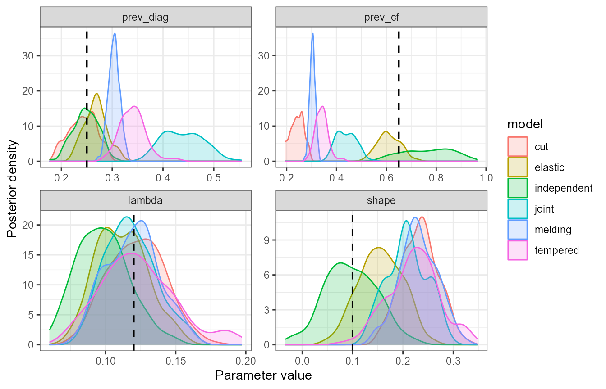
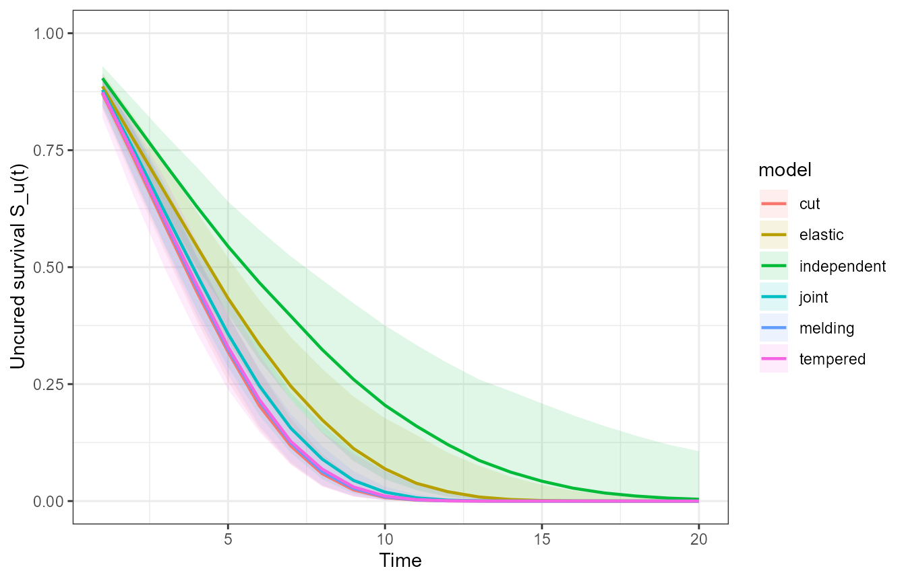

# 1. Comparing Synthesis Models: Cut, Joint, Melding, Elastic, and Tempered Inference

## Overview

In tuberculosis (TB) epidemiology, we often want to combine two
complementary sources of evidence:

1.  **Module 1 (\\M_1\\, Starting State Occupancy / LTBI Survey Data
    \\Y_1\\):** Cross-sectional screening or diagnostic survey data
    informing baseline latent TB infection (LTBI) prevalence
    \\\pi\_{\text{diag}} = \text{logit}^{-1}(\alpha\_{\text{diag}})\\
    and diagnostic test accuracy (\\\text{sens}, \text{spec}\\).
2.  **Module 2 (\\M_2\\, Active TB Progression Survival Data \\Y_2\\):**
    Longitudinal follow-up data \\(t_i, d_i)\_{i=1}^{N\_{\text{surv}}}\\
    informing the uncured progression density \\f_u(t \mid \psi)\\ and
    survival \\S_u(t \mid \psi)\\ (with hazard parameters \\\psi =
    (\lambda, \gamma)\\) alongside the survival cohort’s uncured LTBI
    fraction \\\pi\_{\text{surv}} =
    \text{logit}^{-1}(\alpha\_{\text{surv}})\\.

When both datasets represent the same underlying target population
without selection bias (\\\pi\_{\text{diag}} = \pi\_{\text{surv}}\\), a
**Joint** model pools information across both modules. However, if the
longitudinal progression cohort suffers from selection bias, case-mix
differences, or incomplete follow-up (\\\pi\_{\text{surv}} \neq
\pi\_{\text{diag}}\\), naive joint pooling allows the biased survival
data \\Y_2\\ to corrupt the LTBI prevalence estimate
\\\pi\_{\text{diag}}\\.

`EvidSynthTB` provides **six synthesis strategies** (`"joint"`, `"cut"`,
`"independent"`, `"melding"`, `"elastic"`, and `"tempered"`) together
with quantitative comparison tools
([`compare_evidsynth()`](https://n8thangreen.github.io/EvidSynthTB/reference/compare_evidsynth.md),
[`evaluate_comparison()`](https://n8thangreen.github.io/EvidSynthTB/reference/evaluate_comparison.md),
and
[`diagnose_feedback()`](https://n8thangreen.github.io/EvidSynthTB/reference/diagnose_feedback.md)).

------------------------------------------------------------------------

## Mathematical Formulation of the Six Synthesis Models

### Module Likelihoods

Let \\\phi = (\alpha\_{\text{diag}}, \boldsymbol{\beta}, \text{sens},
\text{spec})\\ denote the Module 1 parameters, where
\\\pi\_{\text{diag}} = \text{logit}^{-1}(\alpha\_{\text{diag}})\\. For
\\M\\ aggregate survey studies with \\y_m\\ positive tests out of
\\n_m\\ individuals tested:

\\ L_1(Y_1 \mid \phi) = \prod\_{m=1}^{M} \binom{n_m}{y_m}
p\_{\text{pos}, m}^{y_m} (1 - p\_{\text{pos}, m})^{n_m - y_m}, \qquad
p\_{\text{pos}, m} = \pi\_{\text{diag}} \\ \text{sens} + (1 -
\pi\_{\text{diag}})(1 - \text{spec}). \\

Let \\\psi = (\lambda, \gamma)\\ denote the uncured survival parameters
in Module 2, with uncured density \\f_u(t_i \mid \psi)\\, uncured
survival \\S_u(t_i \mid \psi)\\, event indicator \\d_i \in \\0, 1\\\\
(\\1 = \text{progressed to active TB}\\, \\0 = \text{right-censored}\\),
and uncured fraction \\\pi\_{\text{surv}} =
\text{logit}^{-1}(\alpha\_{\text{surv}})\\. Since individuals without
LTBI cannot progress to active TB from baseline infection, Module 2
forms a **mixture cure model**:

\\ L_2(Y_2 \mid \alpha\_{\text{surv}}, \psi) =
\prod\_{i=1}^{N\_{\text{surv}}} \left\[ \pi\_{\text{surv}} \\ f_u(t_i
\mid \psi) \right\]^{d_i} \left\[ (1 - \pi\_{\text{surv}}) +
\pi\_{\text{surv}} \\ S_u(t_i \mid \psi) \right\]^{1 - d_i}. \\

------------------------------------------------------------------------

### 1. Full Joint Model (`model = "joint"`)

Assumes \\\alpha\_{\text{surv}} = \alpha\_{\text{diag}} = \alpha\\
(\\\pi\_{\text{surv}} = \pi\_{\text{diag}} = \pi\\) with unrestricted
bidirectional information flow between \\Y_1\\ and \\Y_2\\:

\\ p\_{\text{joint}}(\phi, \psi \mid Y_1, Y_2) \propto p(\phi) \\
p(\psi) \\ L_1(Y_1 \mid \phi) \\ L_2(Y_2 \mid \alpha\_{\text{diag}},
\psi). \\

### 2. Independent Model (`model = "independent"`)

Fits disjoint modules with separate independent priors
\\p(\alpha\_{\text{diag}})\\ and \\p(\alpha\_{\text{surv}})\\ and zero
information sharing:

\\ p\_{\text{ind}}(\phi, \alpha\_{\text{surv}}, \psi \mid Y_1, Y_2) =
p(\phi \mid Y_1) \\ p(\alpha\_{\text{surv}}, \psi \mid Y_2). \\

### 3. True Two-Stage Bayesian Cut Model (`model = "cut"`)

Following Plummer (2015), the **Cut** distribution allows information to
flow forward from the more reliable survey module \\M_1\\ into the
survival module \\M_2\\, while **completely blocking feedback** from
\\Y_2\\ back into \\\phi\\:

\\ p\_{\text{cut}}(\phi, \psi \mid Y_1, Y_2) = p(\phi \mid Y_1) \\
p(\psi \mid Y_2, \phi) = \frac{p(\phi) L_1(Y_1 \mid \phi)}{p(Y_1)} \cdot
\frac{p(\psi) L_2(Y_2 \mid \alpha\_{\text{diag}}, \psi)}{\int p(\psi')
L_2(Y_2 \mid \alpha\_{\text{diag}}, \psi') \\ d\psi'}. \\

Note that integrating out \\\psi\\ yields the exact Stage 1 marginal
\\\int p\_{\text{cut}}(\phi, \psi \mid Y_1, Y_2) \\ d\psi = p(\phi \mid
Y_1)\\, regardless of how misspecified or biased \\Y_2\\ is. In
`EvidSynthTB`, this is implemented via two-stage multiple-imputation
HMC: Stage 1 samples \\\phi^{(s)} \sim p(\phi \mid Y_1)\\ using
`ltbi_module.stan`, and Stage 2 samples \\\psi^{(s)} \sim p(\psi \mid
Y_2, \phi^{(s)})\\ conditional on fixed \\\phi^{(s)}\\.

### 4. Normal Portal / Markov Melding Plug-In (`model = "melding"`)

Summarizes Stage 1 information on the logit prevalence scale via normal
portal summaries \\(\hat{\mu}\_m, \hat{\sigma}\_m)\\ and combines them
with the Stage 2 mixture cure likelihood in a single joint model
(\\\alpha\_{\text{surv}} = \alpha\_{\text{diag}} = \alpha\\):

\\ p\_{\text{meld}}(\alpha, \psi \mid \hat{\mu}, \hat{\sigma}, Y_2)
\propto p(\alpha) \\ p(\psi) \left\[ \prod\_{m=1}^{M}
\mathcal{N}(\hat{\mu}\_m \mid \alpha, \hat{\sigma}\_m^2) \right\]
L_2(Y_2 \mid \alpha, \psi). \\

### 5. Elastic / Hierarchical Coupling (`model = "elastic"`)

Links the diagnostic and survival logit prevalences through a Gaussian
hierarchical prior with tuneable coupling standard deviation \\\tau \>
0\\ (`tau_couple`):

\\ p\_{\text{elastic}}(\phi, \alpha\_{\text{surv}}, \psi \mid Y_1, Y_2)
\propto p(\phi) \\ p(\psi) \\ L_1(Y_1 \mid \phi) \\
\mathcal{N}(\alpha\_{\text{surv}} \mid \alpha\_{\text{diag}}, \tau^2) \\
L_2(Y_2 \mid \alpha\_{\text{surv}}, \psi). \\

- As \\\tau \to 0\\, \\\alpha\_{\text{surv}} \to \alpha\_{\text{diag}}\\
  (**Joint** model).
- As \\\tau \to \infty\\, \\\alpha\_{\text{surv}}\\ and
  \\\alpha\_{\text{diag}}\\ decouple (**Independent** model).

### 6. Tempered / Power-Likelihood Synthesis (`model = "tempered"`)

Down-weights the influence of the survival likelihood \\L_2\\ using a
power weight \\w \in \[0, 1\]\\ (`w_temper`):

\\ p\_{\text{temp}}(\phi, \psi \mid Y_1, Y_2; w) \propto p(\phi) \\
p(\psi) \\ L_1(Y_1 \mid \phi) \\ \left\[ L_2(Y_2 \mid
\alpha\_{\text{diag}}, \psi) \right\]^w. \\

------------------------------------------------------------------------

## Quantitative Metrics for Comparing Models

`EvidSynthTB` provides two dedicated functions to compare models:

1.  **`evaluate_comparison(comp, truth)` (for simulation studies with
    known truth \\\theta\_{\text{true}}\\):**
    - **Bias & RMSE:** \\ \text{Bias}(\hat{\theta}) = \mathbb{E}\[\theta
      \mid Y\] - \theta\_{\text{true}}, \qquad \text{RMSE}(\hat{\theta})
      = \sqrt{\mathbb{E}\\\left\[(\theta - \theta\_{\text{true}})^2 \mid
      Y\right\]}. \\
    - **Uncured Survival Curve Integrated Absolute Error (IAE) &
      Integrated RMSE (IRMSE):** \\ \text{IAE} =
      \frac{1}{t\_{\text{lim}}} \sum\_{t=1}^{t\_{\text{lim}}} \left\|
      \hat{S}\_u(t) - S_u^{\text{true}}(t) \right\|, \qquad \text{IRMSE}
      = \sqrt{\frac{1}{t\_{\text{lim}}} \sum\_{t=1}^{t\_{\text{lim}}}
      \left( \hat{S}\_u(t) - S_u^{\text{true}}(t) \right)^2}. \\
2.  **`diagnose_feedback(comp)` (for both real and simulated data):**
    - **Feedback Shift (\\\Delta\_{\text{fb}}\\):** Measures how
      strongly the survival data pull the diagnostic prevalence
      \\\pi\_{\text{diag}}\\ away from the zero-feedback `"cut"`
      baseline: \\ \Delta\_{\text{fb}}(M) =
      \mathbb{E}\_M\[\pi\_{\text{diag}} \mid Y_1, Y_2\] -
      \mathbb{E}\_{\text{cut}}\[\pi\_{\text{diag}} \mid Y_1\]. \\
    - **Inter-Module Conflict (\\\Delta\_{\text{prev}}\\):** Evaluates
      discrepancy between the survival cure-fraction prevalence and
      survey prevalence (informative in `"independent"` and `"elastic"`
      models): \\ \Delta\_{\text{prev}} = \pi\_{\text{surv}} -
      \pi\_{\text{diag}}, \qquad P\_{\text{conflict}} =
      P(\pi\_{\text{surv}} \> \pi\_{\text{diag}} \mid Y_1, Y_2). \\
    - **Survival WAIC:** Computed from the pointwise survival
      log-likelihood \\\ell\_{i}^{(s)} = \log L\_{2,i}(\theta^{(s)})\\
      across posterior draws \\s = 1, \dots, S\\: \\
      \text{WAIC}\_{\text{surv}} = -2 \sum\_{i=1}^{N\_{\text{surv}}}
      \left( \log \left( \frac{1}{S} \sum\_{s=1}^{S} \exp(\ell_i^{(s)})
      \right) - \text{Var}\_{s}(\ell_i^{(s)}) \right). \\

------------------------------------------------------------------------

## Worked Example: Agreement vs. Conflict Scenarios

``` r

library(EvidSynthTB)
library(dplyr)
library(ggplot2)
```

### Scenario A: Datasets in Agreement (\\\pi\_{\text{diag}} = \pi\_{\text{surv}} = 0.30\\)

``` r

sim_agree <- create_fake_data(
  N_surv = 300,
  n_survey = c(1000, 1000),
  p_ltbi = 0.30,
  p_ltbi_surv = 0.30,
  sens = 0.85,
  spec = 0.95,
  surv_dist = "gompertz",
  shape = 0.10,
  rate = 0.12,
  seed = 101
)

comp_agree <- compare_evidsynth(
  prevalence_data = sim_agree$prevalence_data,
  progression_data = sim_agree$progression_data[, c("t", "d")],
  models = c("joint", "cut", "independent", "melding", "elastic", "tempered"),
  imperfect_test = TRUE,
  chains = 1,
  n_iter = 400,
  n_burnin = 200,
  n_cut_subsamples = 10,
  seed = 101
)

knitr::kable(diagnose_feedback(comp_agree), digits = 3)
```

| model | prev_diag_mean | prev_diag_sd | prev_cf_mean | prev_cf_sd | feedback_shift | conflict_diff_median | conflict_prob_pos | waic_surv | elpd_waic | p_waic |
|:---|---:|---:|---:|---:|---:|---:|---:|---:|---:|---:|
| joint | 0.287 | 0.020 | 0.287 | 0.020 | 0.001 | 0.000 | 0.00 | 608.345 | -304.173 | 1.982 |
| cut | 0.285 | 0.020 | 0.285 | 0.020 | 0.000 | 0.000 | 0.00 | 608.125 | -304.062 | 1.869 |
| independent | 0.282 | 0.032 | 0.495 | 0.207 | -0.004 | 0.161 | 0.85 | 608.547 | -304.274 | 2.240 |
| melding | 0.282 | 0.011 | 0.282 | 0.011 | -0.003 | 0.000 | 0.00 | 607.525 | -303.762 | 1.567 |
| elastic | 0.284 | 0.023 | 0.332 | 0.063 | -0.001 | 0.042 | 0.75 | 608.031 | -304.015 | 1.922 |
| tempered | 0.289 | 0.022 | 0.289 | 0.022 | 0.004 | 0.000 | 0.00 | 611.695 | -305.848 | 3.613 |

When the two data sources agree, `"joint"`, `"cut"`, `"elastic"`, and
`"tempered"` all center near the true prevalence \\\pi = 0.30\\, with
minimal feedback shift (\\\Delta\_{\text{fb}} \approx 0\\).

### Scenario B: Datasets in Conflict (\\\pi\_{\text{diag}} = 0.25\\, \\\pi\_{\text{surv}} = 0.65\\)

Now suppose the progression survival cohort has strong selection bias
(\\\pi\_{\text{surv}} = 0.65\\) relative to the population survey
(\\\pi\_{\text{diag}} = 0.25\\):

``` r

sim_conflict <- create_fake_data(
  N_surv = 300,
  n_survey = c(1000, 1000),
  p_ltbi = 0.25,
  p_ltbi_surv = 0.65,
  sens = 0.85,
  spec = 0.95,
  surv_dist = "gompertz",
  shape = 0.10,
  rate = 0.12,
  seed = 202
)

comp_conflict <- compare_evidsynth(
  prevalence_data = sim_conflict$prevalence_data,
  progression_data = sim_conflict$progression_data[, c("t", "d")],
  models = c("joint", "cut", "independent", "melding", "elastic", "tempered"),
  imperfect_test = TRUE,
  chains = 1,
  n_iter = 400,
  n_burnin = 200,
  n_cut_subsamples = 10,
  seed = 202
)

knitr::kable(diagnose_feedback(comp_conflict), digits = 3)
```

| model | prev_diag_mean | prev_diag_sd | prev_cf_mean | prev_cf_sd | feedback_shift | conflict_diff_median | conflict_prob_pos | waic_surv | elpd_waic | p_waic |
|:---|---:|---:|---:|---:|---:|---:|---:|---:|---:|---:|
| joint | 0.440 | 0.040 | 0.440 | 0.040 | 0.198 | 0.000 | 0 | 1072.122 | -536.061 | 2.905 |
| cut | 0.242 | 0.026 | 0.242 | 0.026 | 0.000 | 0.000 | 0 | 1180.799 | -590.399 | 3.770 |
| independent | 0.248 | 0.025 | 0.766 | 0.099 | 0.006 | 0.527 | 1 | 1045.215 | -522.608 | 2.673 |
| melding | 0.304 | 0.011 | 0.304 | 0.011 | 0.062 | 0.000 | 0 | 1129.555 | -564.777 | 1.906 |
| elastic | 0.268 | 0.022 | 0.611 | 0.046 | 0.026 | 0.341 | 1 | 1047.252 | -523.626 | 2.334 |
| tempered | 0.341 | 0.026 | 0.341 | 0.026 | 0.099 | 0.000 | 0 | 1112.911 | -556.456 | 4.163 |

Notice what happens under conflict:

- **`"cut"`** keeps `prev_diag` strictly anchored to the unbiased Stage
  1 survey posterior (\\\Delta\_{\text{fb}} = 0\\).
- **`"joint"`** and **`"melding"`** pull `prev_diag` upward toward the
  biased survival cohort.
- **`"independent"`** and **`"elastic"`** detect the conflict via
  `conflict_diff_median > 0` and `conflict_prob_pos` near \\1.0\\, while
  keeping `prev_diag` protected from the survival cohort’s upward bias.

``` r

eval_conflict <- evaluate_comparison(comp_conflict, truth = sim_conflict$truth)
knitr::kable(
  dplyr::filter(eval_conflict$parameter_metrics, variable %in% c("prev_diag", "lambda", "shape")),
  digits = 3
)
```

| model | variable | truth | post_mean | post_median | post_sd | bias | rmse | cov_95 | width_95 |
|:---|:---|---:|---:|---:|---:|---:|---:|:---|---:|
| joint | prev_diag | 0.25 | 0.440 | 0.439 | 0.040 | 0.190 | 0.194 | FALSE | 0.140 |
| joint | lambda | 0.12 | 0.118 | 0.116 | 0.018 | -0.002 | 0.018 | TRUE | 0.070 |
| joint | shape | 0.10 | 0.209 | 0.209 | 0.039 | 0.109 | 0.115 | FALSE | 0.141 |
| cut | prev_diag | 0.25 | 0.242 | 0.243 | 0.026 | -0.008 | 0.027 | TRUE | 0.091 |
| cut | lambda | 0.12 | 0.122 | 0.122 | 0.020 | 0.002 | 0.020 | TRUE | 0.075 |
| cut | shape | 0.10 | 0.233 | 0.234 | 0.036 | 0.133 | 0.138 | FALSE | 0.137 |
| independent | prev_diag | 0.25 | 0.248 | 0.249 | 0.025 | -0.002 | 0.025 | TRUE | 0.089 |
| independent | lambda | 0.12 | 0.098 | 0.097 | 0.019 | -0.022 | 0.029 | TRUE | 0.070 |
| independent | shape | 0.10 | 0.097 | 0.095 | 0.051 | -0.003 | 0.051 | TRUE | 0.199 |
| melding | prev_diag | 0.25 | 0.304 | 0.304 | 0.011 | 0.054 | 0.055 | FALSE | 0.042 |
| melding | lambda | 0.12 | 0.119 | 0.120 | 0.019 | -0.001 | 0.019 | TRUE | 0.067 |
| melding | shape | 0.10 | 0.231 | 0.229 | 0.037 | 0.131 | 0.136 | FALSE | 0.149 |
| elastic | prev_diag | 0.25 | 0.268 | 0.268 | 0.022 | 0.018 | 0.028 | TRUE | 0.085 |
| elastic | lambda | 0.12 | 0.111 | 0.110 | 0.018 | -0.009 | 0.020 | TRUE | 0.070 |
| elastic | shape | 0.10 | 0.156 | 0.154 | 0.043 | 0.056 | 0.070 | TRUE | 0.158 |
| tempered | prev_diag | 0.25 | 0.341 | 0.340 | 0.026 | 0.091 | 0.095 | FALSE | 0.105 |
| tempered | lambda | 0.12 | 0.123 | 0.120 | 0.027 | 0.003 | 0.027 | TRUE | 0.107 |
| tempered | shape | 0.10 | 0.221 | 0.222 | 0.051 | 0.121 | 0.132 | FALSE | 0.194 |

``` r


plot_model_comparison(
  comp_conflict,
  variables = c("prev_diag", "prev_cf", "lambda", "shape"),
  truth = c(prev_diag = 0.25, prev_cf = 0.65, lambda = 0.12, shape = 0.10)
)
```



``` r


plot_survival_comparison(comp_conflict, type = "uncured")
```


