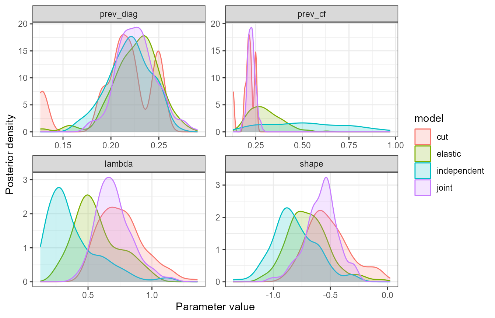
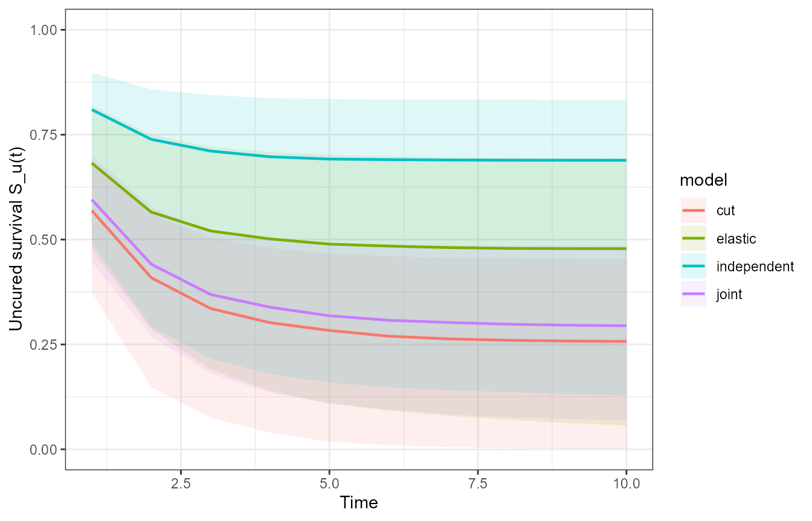
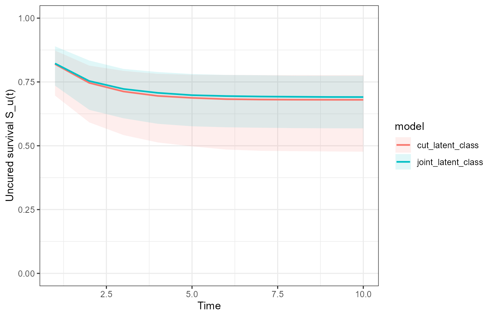

# 3. UK PREDICT-TB Case Studies: Reconstructed Survival & Linked Migrant Cohort

## Overview

The UK PREDICT-TB study (Abubakar et al., 2018) evaluated latent
tuberculosis infection (LTBI) screening and subsequent progression to
active TB among recent migrants and TB contacts in the UK. Depending on
data access, researchers typically encounter two different data
structures from this study:

1.  **Case Study A — Published Aggregate Positivity + Reconstructed
    Kaplan-Meier IPD
    ([`load_abubakar_2018()`](https://n8thangreen.github.io/EvidSynthTB/reference/load_abubakar_2018.md)):**
    From the published paper, we observe the aggregate baseline IGRA
    positivity count (\\y = 1444\\ positive out of \\n = 6380\\
    participants) together with pseudo-individual survival times \\(t_i,
    d_i)\_{i=1}^{6380}\\ reconstructed by digitizing the published
    Kaplan-Meier curve (`scripts/reconstruct-progression-data.R`).
    Because the digitized survival curve does not link individual test
    outcomes \\x_i\\ to individual times \\t_i\\, this is an **unlinked
    two-module synthesis** problem.
2.  **Case Study B — Linked Individual-Level Migrant Cohort
    ([`load_predict_migrant()`](https://n8thangreen.github.io/EvidSynthTB/reference/load_predict_migrant.md)):**
    In the individual-level migrant sub-cohort extract
    (`cleaned_migrant_predict_data.RData`), each participant \\i\\ has a
    linked baseline test result \\x_i \in \\0, 1\\\\, follow-up time
    \\t_i\\, active TB progression indicator \\d_i \in \\0, 1\\\\, and
    demographic covariates (`age`, `age_z`, `ethnicity`). This enables
    **individual-level latent-class coupling** and covariate regression.

------------------------------------------------------------------------

## Mathematical Formulation

### Case Study A: Unlinked Aggregate Survey + Reconstructed Survival Cohort

Let \\y = 1444\\ and \\n = 6380\\ denote the aggregate IGRA positivity
data in Module 1, and let \\(t_i, d_i)\_{i=1}^{N\_{\text{surv}}}\\
denote the digitized progression times in Module 2. With imperfect IGRA
sensitivity and specificity (\\\text{sens} \sim
\text{Beta}(a\_{\text{sens}}, b\_{\text{sens}})\\, \\\text{spec} \sim
\text{Beta}(a\_{\text{spec}}, b\_{\text{spec}})\\) and a Gompertz
uncured progression hazard \\h_u(t) = \lambda e^{\gamma t}\\:

\\ \begin{aligned} y &\sim \text{Binomial}\\\left(n, \\
\pi\_{\text{diag}} \\ \text{sens} + (1 - \pi\_{\text{diag}})(1 -
\text{spec})\right), \\\[4pt\] L_2(t_i, d_i \mid \pi\_{\text{surv}},
\lambda, \gamma) &= \left\[ \pi\_{\text{surv}} \\ \lambda e^{\gamma t_i}
\exp\\\left(-\frac{\lambda}{\gamma}(e^{\gamma t_i} - 1)\right)
\right\]^{d_i} \left\[ (1 - \pi\_{\text{surv}}) + \pi\_{\text{surv}}
\exp\\\left(-\frac{\lambda}{\gamma}(e^{\gamma t_i} - 1)\right)
\right\]^{1 - d_i}. \end{aligned} \\

Because active TB progression events in the full cohort are rare (~1.5%
over 5 years) and follow-up is heavily right-censored around 4–5 years,
fitting Module 2 alone (`model = "independent"`) cannot separately
identify the cure fraction \\1 - \pi\_{\text{surv}}\\ and the Gompertz
shape parameter \\\gamma \< 0\\ (which governs how quickly the
progression hazard decays over time). Linking Module 1 and Module 2 via
`"cut"`, `"joint"`, or `"elastic"` anchors the uncured fraction \\\pi\\
using the diagnostic test data, allowing the survival curve \\S_u(t)\\
among LTBI-positive individuals to be identified.

### Case Study B: Linked Individual-Level Migrant Cohort with Covariates

In the linked migrant cohort, each participant \\i\\ has baseline age
\\a_i\\ (standardized as \\\text{age}\_{z,i}\\), baseline test result
\\x_i \in \\0, 1\\\\, and survival outcome \\(t_i, d_i)\\. Individual
baseline LTBI prevalence is modeled as:

\\ \text{logit}(\pi_i) = \alpha + \beta\_{\text{age}} \\
\text{age}\_{z,i}. \\

Under individual-level latent-class coupling
(`coupling = "latent_class"`), each participant’s latent infection
status \\Z_i \sim \text{Bernoulli}(\pi_i)\\ jointly governs \\x_i\\ and
\\(t_i, d_i)\\:

\\ L_i(x_i, t_i, d_i) = \begin{cases} \pi_i \\ \text{sens}^{x_i} (1 -
\text{sens})^{1 - x_i} \\ f_u(t_i \mid \lambda, \gamma) & \text{if } d_i
= 1, \\\[4pt\] (1 - \pi_i) (1 - \text{spec})^{x_i} \text{spec}^{1 -
x_i} + \pi_i \\ \text{sens}^{x_i} (1 - \text{sens})^{1 - x_i} \\ S_u(t_i
\mid \lambda, \gamma) & \text{if } d_i = 0. \end{cases} \\

------------------------------------------------------------------------

## Worked Analysis: Case Study A (Reconstructed Abubakar 2018 Data)

``` r

library(EvidSynthTB)
library(dplyr)
library(ggplot2)

abub <- load_abubakar_2018()
abub$prevalence_data
#> # A tibble: 1 × 5
#>       y     n test_id mu_hat sigma_hat
#>   <int> <int>   <int>  <dbl>     <dbl>
#> 1  1444  6380       1  -1.23    0.0299
head(abub$progression_data)
#> # A tibble: 6 × 2
#>        t     d
#>    <dbl> <int>
#> 1 0.0601     1
#> 2 0.0601     1
#> 3 0.0601     1
#> 4 0.0601     1
#> 5 0.0601     1
#> 6 0.0601     1
```

For computational speed in this vignette, we take a stratified subsample
including all observed active TB events (\\d_i = 1\\) and a weighted
sample of censored observations (in a full analysis, as in
`scripts/script_Stan.R`, pass `abub$progression_data` directly):

``` r

set.seed(501)
events_df <- dplyr::filter(abub$progression_data, d == 1L)
cens_df <- dplyr::slice_sample(dplyr::filter(abub$progression_data, d == 0L), n = 450)
prog_sub <- dplyr::bind_rows(events_df, cens_df)

comp_abub <- compare_evidsynth(
  prevalence_data = abub$prevalence_data,
  progression_data = prog_sub,
  models = c("cut", "joint", "independent", "elastic"),
  imperfect_test = TRUE,
  surv_dist = "gompertz",
  t_lim = 10,
  chains = 1,
  n_iter = 400,
  n_burnin = 200,
  n_cut_subsamples = 8,
  seed = 501
)

knitr::kable(comp_abub$summary_table, digits = 3)
```

| model | variable | mean | median | sd | mad | q5 | q95 | rhat | ess_bulk | ess_tail |
|:---|:---|---:|---:|---:|---:|---:|---:|---:|---:|---:|
| cut | prev_diag | 0.210 | 0.215 | 0.036 | 0.025 | 0.128 | 0.250 | 1.087 | 10.471 | NA |
| cut | prev_cf | 0.210 | 0.215 | 0.036 | 0.025 | 0.128 | 0.250 | 1.087 | 10.471 | NA |
| cut | ppv_cf | 0.780 | 0.790 | 0.137 | 0.113 | 0.498 | 0.962 | 1.029 | 11.012 | NA |
| cut | lambda | 0.765 | 0.746 | 0.176 | 0.174 | 0.523 | 1.110 | 1.005 | 26.671 | 94.012 |
| cut | shape | -0.515 | -0.548 | 0.192 | 0.176 | -0.799 | -0.138 | 1.038 | 23.582 | 27.271 |
| cut | sens\[1\] | 0.845 | 0.845 | 0.031 | 0.029 | 0.792 | 0.892 | 1.232 | 9.384 | NA |
| cut | spec\[1\] | 0.938 | 0.939 | 0.036 | 0.030 | 0.868 | 0.989 | 1.029 | 11.012 | NA |
| joint | prev_diag | 0.227 | 0.225 | 0.020 | 0.018 | 0.195 | 0.260 | 0.996 | 48.672 | 86.533 |
| joint | prev_cf | 0.227 | 0.225 | 0.020 | 0.018 | 0.195 | 0.260 | 0.996 | 48.672 | 86.533 |
| joint | ppv_cf | 0.846 | 0.853 | 0.058 | 0.059 | 0.748 | 0.929 | 0.997 | 103.634 | 112.631 |
| joint | lambda | 0.703 | 0.686 | 0.140 | 0.130 | 0.510 | 0.961 | 1.017 | 102.416 | 95.185 |
| joint | shape | -0.579 | -0.569 | 0.143 | 0.126 | -0.834 | -0.327 | 1.001 | 118.988 | 94.806 |
| joint | sens\[1\] | 0.846 | 0.849 | 0.037 | 0.038 | 0.777 | 0.901 | 0.995 | 49.006 | 153.250 |
| joint | spec\[1\] | 0.955 | 0.957 | 0.016 | 0.016 | 0.928 | 0.978 | 0.998 | 110.348 | 112.631 |
| independent | prev_diag | 0.219 | 0.220 | 0.022 | 0.022 | 0.179 | 0.253 | 1.003 | 137.634 | 118.977 |
| independent | prev_cf | 0.519 | 0.505 | 0.211 | 0.257 | 0.204 | 0.859 | 0.998 | 58.921 | 93.294 |
| independent | ppv_cf | 0.927 | 0.952 | 0.065 | 0.048 | 0.799 | 0.992 | 1.002 | 69.485 | 118.952 |
| independent | lambda | 0.383 | 0.316 | 0.205 | 0.160 | 0.162 | 0.770 | 0.999 | 59.651 | 114.734 |
| independent | shape | -0.810 | -0.834 | 0.194 | 0.173 | -1.091 | -0.484 | 0.996 | 128.075 | 112.891 |
| independent | sens\[1\] | 0.849 | 0.850 | 0.035 | 0.036 | 0.788 | 0.905 | 1.006 | 92.593 | 57.981 |
| independent | spec\[1\] | 0.948 | 0.951 | 0.021 | 0.021 | 0.910 | 0.977 | 1.015 | 165.379 | 154.496 |
| elastic | prev_diag | 0.226 | 0.229 | 0.025 | 0.021 | 0.191 | 0.261 | 0.998 | 130.156 | 93.503 |
| elastic | prev_cf | 0.302 | 0.290 | 0.087 | 0.085 | 0.188 | 0.451 | 1.010 | 126.591 | 127.637 |
| elastic | ppv_cf | 0.879 | 0.894 | 0.068 | 0.059 | 0.756 | 0.968 | 0.999 | 115.794 | 79.617 |
| elastic | lambda | 0.569 | 0.533 | 0.179 | 0.154 | 0.307 | 0.911 | 1.006 | 131.835 | 129.115 |
| elastic | shape | -0.691 | -0.709 | 0.186 | 0.170 | -0.953 | -0.381 | 1.006 | 164.517 | 103.715 |
| elastic | sens\[1\] | 0.844 | 0.845 | 0.037 | 0.033 | 0.781 | 0.899 | 1.016 | 119.071 | 75.233 |
| elastic | spec\[1\] | 0.954 | 0.957 | 0.021 | 0.018 | 0.919 | 0.981 | 0.996 | 123.311 | 95.649 |

``` r

knitr::kable(diagnose_feedback(comp_abub), digits = 3)
```

| model | prev_diag_mean | prev_diag_sd | prev_cf_mean | prev_cf_sd | feedback_shift | conflict_diff_median | conflict_prob_pos | waic_surv | elpd_waic | p_waic |
|:---|---:|---:|---:|---:|---:|---:|---:|---:|---:|---:|
| cut | 0.210 | 0.036 | 0.210 | 0.036 | 0.000 | 0.000 | 0.00 | 548.795 | -274.397 | 2.325 |
| joint | 0.227 | 0.020 | 0.227 | 0.020 | 0.017 | 0.000 | 0.00 | 548.249 | -274.125 | 2.022 |
| independent | 0.219 | 0.022 | 0.519 | 0.211 | 0.009 | 0.287 | 0.94 | 549.514 | -274.757 | 2.172 |
| elastic | 0.226 | 0.025 | 0.302 | 0.087 | 0.016 | 0.062 | 0.83 | 548.773 | -274.386 | 2.113 |

``` r

plot_model_comparison(
  comp_abub,
  variables = c("prev_diag", "prev_cf", "lambda", "shape")
)
```



``` r

plot_survival_comparison(comp_abub, type = "uncured")
```



Notice that the Gompertz shape parameter \\\gamma\\ (`shape`) is
estimated to be negative, reflecting the biological reality that the
hazard of progressing from LTBI to active TB is highest in the first 1–2
years after entry/screening and decays exponentially thereafter.

------------------------------------------------------------------------

## Worked Analysis: Case Study B (Linked PREDICT-TB Migrant Cohort)

``` r

migrant <- load_predict_migrant()
glimpse(migrant$progression_data)
#> Rows: 4,560
#> Columns: 7
#> $ t         <dbl> 3.928816, 3.652293, 5.232033, 3.904175, 6.047912, 3.603012, …
#> $ d         <int> 0, 0, 0, 0, 0, 0, 0, 0, 0, 0, 0, 0, 0, 0, 0, 0, 0, 0, 0, 0, …
#> $ x         <int> 0, 0, 1, 1, 0, 0, 0, 0, 1, 0, 0, 0, 0, 0, 0, 0, 0, 1, 0, 0, …
#> $ x1        <int> 0, 0, 1, 1, 0, 0, 0, 0, 1, 0, 0, 0, 0, 0, 0, 0, 0, 1, 0, 0, …
#> $ age       <dbl> 39, 25, 22, 37, 23, 60, 31, 61, 51, 32, 63, 37, 53, 33, 30, …
#> $ age_z     <dbl> 0.01730446, -0.84373739, -1.02824635, -0.10570152, -0.966743…
#> $ ethnicity <fct> "Black other, Chinese or other", "Bangladeshi", "Bangladeshi…
```

We compare individual-level `"latent_class"` coupling against
`"population"` coupling and the two-stage `"cut"` model on a stratified
subsample of the linked migrant cohort with standardized age (`age_z`)
as a baseline covariate:

``` r

set.seed(601)
mig_events <- dplyr::filter(migrant$progression_data, d == 1L)
mig_cens <- dplyr::slice_sample(dplyr::filter(migrant$progression_data, d == 0L), n = 400)
mig_sub <- dplyr::bind_rows(mig_events, mig_cens)

fit_mig_lc <- evidsynth_fit(
  prevalence_data = migrant$prevalence_data,
  progression_data = mig_sub,
  model = "joint",
  coupling = "latent_class",
  imperfect_test = TRUE,
  covariates = "age_z",
  t_lim = 10,
  chains = 1,
  n_iter = 400,
  n_burnin = 200,
  seed = 601
)

fit_mig_cut <- evidsynth_fit(
  prevalence_data = migrant$prevalence_data,
  progression_data = mig_sub,
  model = "cut",
  coupling = "latent_class",
  imperfect_test = TRUE,
  covariates = "age_z",
  t_lim = 10,
  chains = 1,
  n_iter = 400,
  n_burnin = 200,
  n_cut_subsamples = 8,
  seed = 601
)

comp_migrant <- structure(
  list(
    fits = list(joint_latent_class = fit_mig_lc, cut_latent_class = fit_mig_cut),
    summary_table = bind_rows(
      mutate(fit_mig_lc$summary, model = "joint_latent_class"),
      mutate(fit_mig_cut$summary, model = "cut_latent_class")
    )
  ),
  class = "evidsynth_comparison"
)

knitr::kable(comp_migrant$summary_table, digits = 3)
```

| variable | mean | median | sd | mad | q5 | q95 | rhat | ess_bulk | ess_tail | model |
|:---|---:|---:|---:|---:|---:|---:|---:|---:|---:|:---|
| prev_diag | 0.228 | 0.231 | 0.034 | 0.038 | 0.174 | 0.277 | 1.027 | 91.149 | 154.069 | joint_latent_class |
| prev_cf | 0.228 | 0.231 | 0.034 | 0.038 | 0.174 | 0.277 | 1.027 | 91.149 | 154.069 | joint_latent_class |
| ppv_cf | 0.747 | 0.765 | 0.102 | 0.112 | 0.571 | 0.886 | 1.027 | 93.531 | 147.634 | joint_latent_class |
| lambda | 0.285 | 0.282 | 0.077 | 0.068 | 0.164 | 0.433 | 1.019 | 60.516 | 95.185 | joint_latent_class |
| shape | -0.755 | -0.762 | 0.158 | 0.151 | -1.024 | -0.526 | 1.019 | 138.439 | 71.084 | joint_latent_class |
| sens\[1\] | 0.802 | 0.803 | 0.035 | 0.034 | 0.746 | 0.854 | 1.005 | 126.920 | 113.118 | joint_latent_class |
| spec\[1\] | 0.921 | 0.925 | 0.028 | 0.031 | 0.871 | 0.963 | 1.025 | 99.930 | 132.876 | joint_latent_class |
| prev_diag | 0.203 | 0.214 | 0.049 | 0.042 | 0.096 | 0.263 | 0.995 | 7.927 | NA | cut_latent_class |
| prev_cf | 0.203 | 0.214 | 0.049 | 0.042 | 0.096 | 0.263 | 0.995 | 7.927 | NA | cut_latent_class |
| ppv_cf | 0.697 | 0.697 | 0.163 | 0.136 | 0.355 | 0.895 | 1.232 | 8.435 | NA | cut_latent_class |
| lambda | 0.301 | 0.290 | 0.085 | 0.084 | 0.191 | 0.441 | 1.028 | 16.801 | 14.642 | cut_latent_class |
| shape | -0.737 | -0.732 | 0.151 | 0.133 | -0.964 | -0.490 | 1.009 | 71.551 | 107.403 | cut_latent_class |
| sens\[1\] | 0.836 | 0.834 | 0.032 | 0.040 | 0.783 | 0.882 | 1.078 | 9.920 | NA | cut_latent_class |
| spec\[1\] | 0.911 | 0.907 | 0.041 | 0.041 | 0.832 | 0.966 | 1.357 | 8.226 | NA | cut_latent_class |

``` r

knitr::kable(diagnose_feedback(comp_migrant), digits = 3)
```

| model | prev_diag_mean | prev_diag_sd | prev_cf_mean | prev_cf_sd | feedback_shift | conflict_diff_median | conflict_prob_pos | waic_surv | elpd_waic | p_waic |
|:---|---:|---:|---:|---:|---:|---:|---:|---:|---:|---:|
| joint_latent_class | 0.228 | 0.034 | 0.228 | 0.034 | 0.000 | 0 | 0 | 316.799 | -158.400 | 3.328 |
| cut_latent_class | 0.203 | 0.049 | 0.203 | 0.049 | -0.024 | 0 | 0 | 321.203 | -160.601 | 4.382 |

``` r

plot_survival_comparison(comp_migrant, type = "uncured")
```


