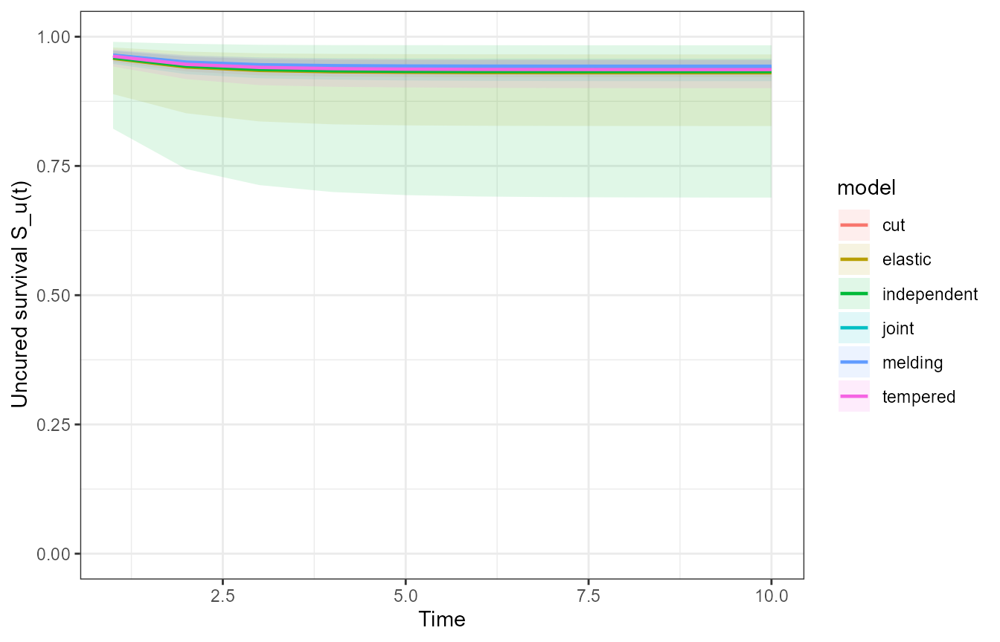
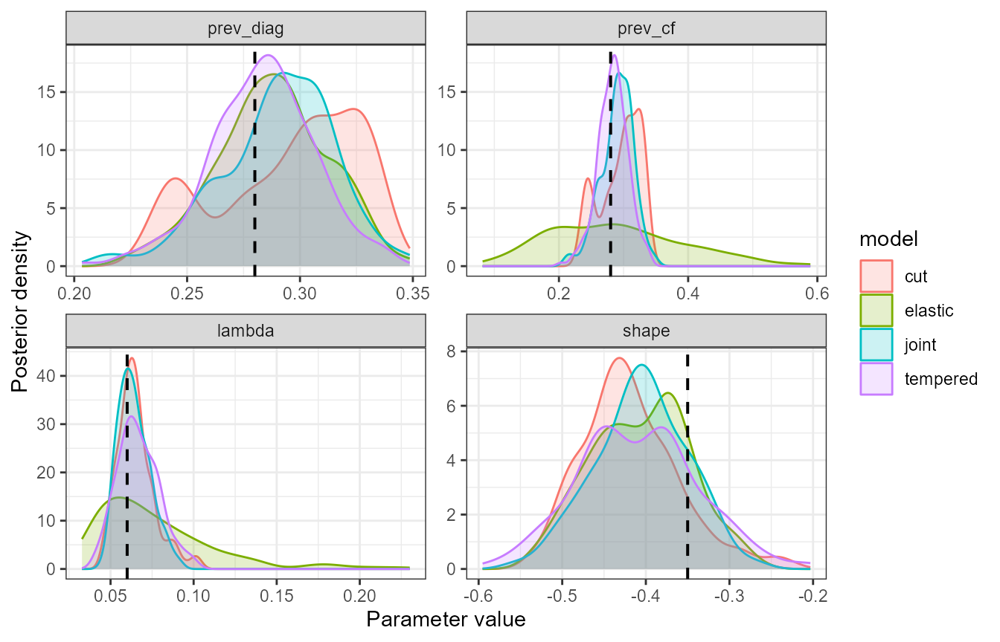

# 4. Evidence Synthesis from Published Summary Tables and UKHSA Surveillance Reports

## Overview

In most evidence synthesis applications for tuberculosis (TB),
researchers do **not** have access to linked individual participant data
(IPD). Instead, evidence must be synthesized from published literature
and routine public health reports:

1.  **LTBI Testing Data (\\M_1\\, from published summary tables):**
    Tables in screening papers report subgroup sample sizes \\N_g\\,
    positive test counts \\y_g\\, and group-level risk factors
    \\\mathbf{x}\_g\\ (e.g., age group, TB incidence in country of
    birth, reason for screening).
2.  **Active TB Progression Data (\\M_2\\, from papers or UKHSA / ETS
    reports):** Published progression evidence typically arrives in one
    of three aggregate formats:
    - **Format A — Cumulative Subgroup Case Counts:** Number of active
      TB cases \\d_g\\ out of cohort size \\N_g\\ over a cumulative
      follow-up window \\\[0, T_g\]\\ (as in
      [`load_predict_aggregated()`](https://n8thangreen.github.io/EvidSynthTB/reference/load_predict_aggregated.md)
      / `raw-data/aggregated_data.csv`).
    - **Format B — Annual / Interval Surveillance Counts by Time Since
      Entry:** Active TB notifications \\d_g\\ occurring in time
      interval \\\[t\_{0,g}, t\_{1,g}\]\\ (e.g., Year 0–1, Year 1–2, …,
      Year 4–5 after UK arrival in UKHSA Enhanced TB Surveillance
      reports) out of an initial entry cohort \\N_g\\.
    - **Format C — Published Kaplan-Meier Life Tables:** Digitized
      survival intervals \\\[t\_{0,g}, t\_{1,g}\]\\ with number at risk
      \\R_g\\ (`n_risk`) and interval event counts \\d_g\\ (`d`), as in
      [`load_abubakar_km()`](https://n8thangreen.github.io/EvidSynthTB/reference/load_abubakar_km.md)
      (`raw-data/KMdata.txt`).

[`evidsynth_fit()`](https://n8thangreen.github.io/EvidSynthTB/reference/evidsynth_fit.md)
and
[`compare_evidsynth()`](https://n8thangreen.github.io/EvidSynthTB/reference/compare_evidsynth.md)
accept all three published data formats directly in
`progression_data`—without requiring any individual-level rows—and
support all six synthesis strategies (`"cut"`, `"joint"`,
`"independent"`, `"melding"`, `"elastic"`, and `"tempered"`).

------------------------------------------------------------------------

## Mathematical Formulation for Published Aggregate & Interval Data

For any published stratum or time interval \\g = 1, \dots,
G\_{\text{surv}}\\ spanning time window \\\[t\_{0,g}, t\_{1,g}\]\\ with
group covariate vector \\\mathbf{x}\_g\\:

### 1. Module 1: Subgroup LTBI Positivity Table

Let \\\pi\_{\text{diag}, m} = \text{logit}^{-1}(\alpha\_{\text{diag}} +
\mathbf{x}\_m^\top \boldsymbol{\beta})\\ denote the true LTBI prevalence
in published stratum \\m = 1, \dots, M\_{\text{agg}}\\. With test
sensitivity \\\text{sens}\_k\\ and specificity \\\text{spec}\_k\\:

\\ y_m \sim \text{Binomial}(N_m, \\ p\_{\text{pos}, m}), \qquad
p\_{\text{pos}, m} = \pi\_{\text{diag}, m} \\ \text{sens}\_k + (1 -
\pi\_{\text{diag}, m})(1 - \text{spec}\_k). \\

### 2. Module 2: Unified Mixture Cure Interval Likelihood

Let \\\pi\_{\text{surv}, g} = \text{logit}^{-1}(\alpha\_{\text{surv}} +
\mathbf{x}\_g^\top \boldsymbol{\beta})\\ denote the survival module’s
baseline LTBI prevalence in group \\g\\, and let \\\tilde{\pi}\_g\\
denote the effective uncured fraction (\\\tilde{\pi}\_g =
\pi\_{\text{surv}, g}\\ for an unselected cohort `cohort_type = "all"`,
or \\\tilde{\pi}\_g = \text{PPV}\_g\\ for a test-positive cohort
`cohort_type = "pos_only"`).

Under the mixture cure model with uncured survival function \\S_u(t \mid
\lambda, \gamma)\\, the population survival at time \\t\\ is:

\\ S\_{\text{pop}, g}(t) = (1 - \tilde{\pi}\_g) + \tilde{\pi}\_g \\
S_u(t \mid \lambda, \gamma). \\

The probability that an infected individual progresses to active TB
during interval \\\[t\_{0,g}, t\_{1,g}\]\\ is \\\tilde{\pi}\_g \left\[
S_u(t\_{0,g}) - S_u(t\_{1,g}) \right\]\\. This yields exact Binomial
likelihoods for all three published formats:

#### Format A: Cumulative Subgroup Table over \\\[0, T_g\]\\ (\\t\_{0,g} = 0, t\_{1,g} = T_g\\, Denominator = Cohort Size \\N_g\\)

Since \\S_u(0) = 1\\, the cumulative probability of active TB over
\\\[0, T_g\]\\ in group \\g\\ is:

\\ p_g = \tilde{\pi}\_g \left\[ 1 - S_u(T_g \mid \lambda, \gamma)
\right\], \qquad d_g \sim \text{Binomial}(N_g, \\ p_g). \\

*(Note: In earlier BUGS/JAGS implementations, the latent integer count
\\X\_{\text{latent}, g} = \lfloor \pi_g N_g \rfloor\\ had to be
truncated to pass as a binomial denominator for \\X\_{\text{TB}, g} \sim
\text{Binomial}(X\_{\text{latent}, g}, \lambda)\\. Marginalizing over
the latent binomial count \\X\_{\text{latent}, g} \sim
\text{Binomial}(N_g, \tilde{\pi}\_g)\\ yields the exact analytical
binomial distribution \\\text{Binomial}(N_g, \tilde{\pi}\_g \[1 -
S_u(T_g)\])\\ with smooth HMC gradients!)*

#### Format B: UKHSA / ETS Annual Surveillance Counts in \\\[t\_{0,g}, t\_{1,g}\]\\ (Denominator = Initial Entry Cohort \\N_g\\)

When a surveillance report tabulates annual active TB cases \\d_g\\ in
Year 0–1 (\\\[0,1\]\\), Year 1–2 (\\\[1,2\]\\), …, Year \\L-1\\ to \\L\\
(\\\[L-1, L\]\\) relative to the initial entry cohort denominator
\\N_g\\:

\\ p_g = S\_{\text{pop}, g}(t\_{0,g}) - S\_{\text{pop}, g}(t\_{1,g}) =
\tilde{\pi}\_g \left\[ S_u(t\_{0,g} \mid \lambda, \gamma) - S_u(t\_{1,g}
\mid \lambda, \gamma) \right\], \qquad d_g \sim \text{Binomial}(N_g, \\
p_g). \\

#### Format C: Published Kaplan-Meier Life Table in \\\[t\_{0,g}, t\_{1,g}\]\\ (Denominator = Risk Set \\R_g\\ at \\t\_{0,g}\\)

When a digitized Kaplan-Meier curve or life table reports the number
still at risk \\R_g\\ (`n_risk`) at the start of interval \\t\_{0,g}\\,
we condition on survival up to \\t\_{0,g}\\ (\\T \> t\_{0,g}\\):

\\ q_g = P(T \in (t\_{0,g}, t\_{1,g}\] \mid T \> t\_{0,g}) =
\frac{\tilde{\pi}\_g \left\[ S_u(t\_{0,g} \mid \lambda, \gamma) -
S_u(t\_{1,g} \mid \lambda, \gamma) \right\]}{(1 - \tilde{\pi}\_g) +
\tilde{\pi}\_g \\ S_u(t\_{0,g} \mid \lambda, \gamma)}, \qquad d_g \sim
\text{Binomial}(R_g, \\ q_g). \\

------------------------------------------------------------------------

## Worked Examples

``` r

library(EvidSynthTB)
library(dplyr)
library(ggplot2)
```

### Example 1: Published Kaplan-Meier Life Table (`load_abubakar_km()`)

Instead of reconstructing 6,380 pseudo-individual rows
([`load_abubakar_2018()`](https://n8thangreen.github.io/EvidSynthTB/reference/load_abubakar_2018.md)),
[`load_abubakar_km()`](https://n8thangreen.github.io/EvidSynthTB/reference/load_abubakar_km.md)
loads the 69 published Kaplan-Meier intervals (`t_start`, `t_end`,
`n_risk`, `d`) alongside the aggregate IGRA count (\\y = 1444, n =
6380\\). Because Stan evaluates 69 binomial interval terms rather than
6,380 individual rows, all 6 synthesis models fit in seconds on the
exact published data:

``` r

abub_km <- load_abubakar_km()
head(abub_km$progression_data)
#> # A tibble: 6 × 5
#>   t_start  t_end n_risk     d n_censored
#>     <dbl>  <dbl>  <int> <int>      <int>
#> 1  0      0.0601   6380     0          6
#> 2  0.0601 0.0840   6374     6          2
#> 3  0.0840 0.0959   6366     0          1
#> 4  0.0959 0.108    6365     0          1
#> 5  0.108  0.120    6364     7          2
#> 6  0.120  0.144    6355     0          2

comp_km <- compare_evidsynth(
  prevalence_data = abub_km$prevalence_data,
  progression_data = abub_km$progression_data,
  models = c("cut", "joint", "independent", "melding", "elastic", "tempered"),
  imperfect_test = TRUE,
  surv_dist = "gompertz",
  t_lim = 10,
  chains = 1,
  n_iter = 400,
  n_burnin = 200,
  n_cut_subsamples = 10,
  seed = 401
)

knitr::kable(comp_km$summary_table, digits = 3)
```

| model | variable | mean | median | sd | mad | q5 | q95 | rhat | ess_bulk | ess_tail |
|:---|:---|---:|---:|---:|---:|---:|---:|---:|---:|---:|
| cut | prev_diag | 0.216 | 0.216 | 0.017 | 0.019 | 0.192 | 0.245 | 1.016 | 13.973 | NA |
| cut | prev_cf | 0.216 | 0.216 | 0.017 | 0.019 | 0.192 | 0.245 | 1.016 | 13.973 | NA |
| cut | ppv_cf | 0.796 | 0.790 | 0.049 | 0.048 | 0.707 | 0.865 | 1.043 | 10.842 | NA |
| cut | lambda | 0.060 | 0.059 | 0.011 | 0.011 | 0.043 | 0.077 | 1.006 | 43.450 | 72.103 |
| cut | shape | -0.957 | -0.951 | 0.116 | 0.116 | -1.145 | -0.774 | 1.017 | 75.969 | 119.860 |
| cut | sens\[1\] | 0.832 | 0.820 | 0.041 | 0.049 | 0.776 | 0.913 | 1.571 | 2.247 | NA |
| cut | spec\[1\] | 0.942 | 0.940 | 0.014 | 0.011 | 0.915 | 0.961 | 1.045 | 13.456 | NA |
| joint | prev_diag | 0.220 | 0.222 | 0.026 | 0.025 | 0.172 | 0.261 | 1.005 | 99.293 | 178.629 |
| joint | prev_cf | 0.220 | 0.222 | 0.026 | 0.025 | 0.172 | 0.261 | 1.005 | 99.293 | 178.629 |
| joint | ppv_cf | 0.816 | 0.834 | 0.088 | 0.078 | 0.651 | 0.933 | 1.021 | 126.032 | 89.111 |
| joint | lambda | 0.058 | 0.058 | 0.012 | 0.011 | 0.042 | 0.082 | 1.004 | 151.244 | 113.499 |
| joint | shape | -0.954 | -0.958 | 0.128 | 0.123 | -1.164 | -0.763 | 0.998 | 161.513 | 154.069 |
| joint | sens\[1\] | 0.844 | 0.848 | 0.039 | 0.035 | 0.770 | 0.901 | 1.055 | 40.692 | 43.633 |
| joint | spec\[1\] | 0.948 | 0.951 | 0.023 | 0.022 | 0.906 | 0.980 | 1.019 | 122.001 | 89.111 |
| independent | prev_diag | 0.219 | 0.221 | 0.024 | 0.023 | 0.172 | 0.252 | 1.001 | 96.876 | 106.358 |
| independent | prev_cf | 0.247 | 0.190 | 0.196 | 0.143 | 0.051 | 0.671 | 0.998 | 56.968 | 86.900 |
| independent | ppv_cf | 0.769 | 0.816 | 0.170 | 0.147 | 0.449 | 0.976 | 1.006 | 57.832 | 93.832 |
| independent | lambda | 0.094 | 0.065 | 0.085 | 0.051 | 0.019 | 0.262 | 1.003 | 54.965 | 78.462 |
| independent | shape | -0.949 | -0.948 | 0.139 | 0.144 | -1.179 | -0.730 | 1.002 | 109.447 | 154.069 |
| independent | sens\[1\] | 0.849 | 0.850 | 0.034 | 0.035 | 0.792 | 0.907 | 1.007 | 138.263 | 103.236 |
| independent | spec\[1\] | 0.948 | 0.951 | 0.022 | 0.021 | 0.908 | 0.977 | 1.014 | 87.825 | 147.256 |
| melding | prev_diag | 0.227 | 0.228 | 0.005 | 0.006 | 0.218 | 0.235 | 1.015 | 116.154 | 147.256 |
| melding | prev_cf | 0.227 | 0.228 | 0.005 | 0.006 | 0.218 | 0.235 | 1.015 | 116.154 | 147.256 |
| melding | ppv_cf | 0.840 | 0.845 | 0.063 | 0.064 | 0.727 | 0.931 | 1.005 | 189.336 | 125.441 |
| melding | lambda | 0.056 | 0.056 | 0.009 | 0.009 | 0.042 | 0.070 | 1.034 | 157.676 | 70.802 |
| melding | shape | -0.950 | -0.958 | 0.147 | 0.151 | -1.168 | -0.688 | 1.017 | 173.462 | 128.337 |
| melding | sens\[1\] | 0.850 | 0.853 | 0.033 | 0.035 | 0.793 | 0.898 | 1.014 | 377.463 | 93.817 |
| melding | spec\[1\] | 0.951 | 0.956 | 0.023 | 0.021 | 0.909 | 0.980 | 0.999 | 186.733 | 96.061 |
| elastic | prev_diag | 0.215 | 0.217 | 0.024 | 0.022 | 0.173 | 0.254 | 1.019 | 119.775 | 99.622 |
| elastic | prev_cf | 0.197 | 0.189 | 0.075 | 0.080 | 0.094 | 0.327 | 1.046 | 147.839 | 80.343 |
| elastic | ppv_cf | 0.775 | 0.792 | 0.116 | 0.120 | 0.562 | 0.937 | 1.000 | 120.880 | 154.069 |
| elastic | lambda | 0.076 | 0.067 | 0.037 | 0.024 | 0.036 | 0.147 | 1.048 | 139.633 | 81.544 |
| elastic | shape | -0.960 | -0.943 | 0.141 | 0.151 | -1.190 | -0.732 | 1.057 | 154.828 | 131.792 |
| elastic | sens\[1\] | 0.853 | 0.855 | 0.030 | 0.025 | 0.798 | 0.895 | 0.997 | 198.009 | 113.499 |
| elastic | spec\[1\] | 0.946 | 0.949 | 0.022 | 0.018 | 0.909 | 0.977 | 1.053 | 116.579 | 126.755 |
| tempered | prev_diag | 0.208 | 0.216 | 0.032 | 0.036 | 0.152 | 0.252 | 1.039 | 42.619 | 131.792 |
| tempered | prev_cf | 0.208 | 0.216 | 0.032 | 0.036 | 0.152 | 0.252 | 1.039 | 42.619 | 131.792 |
| tempered | ppv_cf | 0.779 | 0.798 | 0.108 | 0.124 | 0.598 | 0.919 | 1.046 | 38.171 | 116.395 |
| tempered | lambda | 0.060 | 0.060 | 0.016 | 0.015 | 0.037 | 0.087 | 1.047 | 38.029 | 88.842 |
| tempered | shape | -0.882 | -0.860 | 0.190 | 0.177 | -1.220 | -0.601 | 1.043 | 157.297 | 44.655 |
| tempered | sens\[1\] | 0.852 | 0.854 | 0.032 | 0.030 | 0.795 | 0.902 | 0.999 | 153.442 | 133.349 |
| tempered | spec\[1\] | 0.938 | 0.942 | 0.028 | 0.033 | 0.890 | 0.975 | 1.046 | 38.283 | 128.893 |

``` r

knitr::kable(diagnose_feedback(comp_km), digits = 3)
```

| model | prev_diag_mean | prev_diag_sd | prev_cf_mean | prev_cf_sd | feedback_shift | conflict_diff_median | conflict_prob_pos | waic_surv | elpd_waic | p_waic |
|:---|---:|---:|---:|---:|---:|---:|---:|---:|---:|---:|
| cut | 0.216 | 0.017 | 0.216 | 0.017 | 0.000 | 0.000 | 0.00 | 494.345 | -247.172 | 9.914 |
| joint | 0.220 | 0.026 | 0.220 | 0.026 | 0.004 | 0.000 | 0.00 | 495.921 | -247.960 | 11.044 |
| independent | 0.219 | 0.024 | 0.247 | 0.196 | 0.003 | -0.030 | 0.44 | 493.347 | -246.674 | 9.178 |
| melding | 0.227 | 0.005 | 0.227 | 0.005 | 0.011 | 0.000 | 0.00 | 495.944 | -247.972 | 11.025 |
| elastic | 0.215 | 0.024 | 0.197 | 0.075 | -0.001 | -0.024 | 0.38 | 497.106 | -248.553 | 12.308 |
| tempered | 0.208 | 0.032 | 0.208 | 0.032 | -0.008 | 0.000 | 0.00 | 510.156 | -255.078 | 21.016 |

``` r

plot_survival_comparison(comp_km, type = "uncured")
```



### Example 2: UKHSA / ETS Annual Surveillance Counts by Year Since Entry

Next, consider combining a published LTBI survey (\\y\\ positive out of
\\n\\ tested) with an annual surveillance report (such as UKHSA Enhanced
TB Surveillance linked to migrant entry denominators) reporting active
TB cases in Years 1 through 5 after entry:

``` r

pub_sim <- create_fake_published_data(
  n_groups = 6,
  n_per_group = 500,
  n_surveillance = 5000,
  p_ltbi = 0.28,
  p_ltbi_surv = 0.28,
  sens = 0.85,
  spec = 0.95,
  surv_dist = "gompertz",
  shape = -0.35,
  rate = 0.06,
  t_horizon = 5,
  seed = 402
)

knitr::kable(pub_sim$interval_table)
```

| year_since_entry | t_start | t_end |    n |   d |
|-----------------:|--------:|------:|-----:|----:|
|                1 |       0 |     1 | 5000 |  75 |
|                2 |       1 |     2 | 5000 |  43 |
|                3 |       2 |     3 | 5000 |  37 |
|                4 |       3 |     4 | 5000 |  19 |
|                5 |       4 |     5 | 5000 |  11 |

``` r


comp_ukhsa <- compare_evidsynth(
  prevalence_data = pub_sim$prevalence_data,
  progression_data = pub_sim$interval_table,
  models = c("cut", "joint", "elastic", "tempered"),
  imperfect_test = TRUE,
  surv_dist = "gompertz",
  t_lim = 10,
  chains = 1,
  n_iter = 400,
  n_burnin = 200,
  n_cut_subsamples = 10,
  seed = 402
)

knitr::kable(
  evaluate_comparison(comp_ukhsa, truth = pub_sim$truth)$parameter_metrics,
  digits = 3
)
```

| model | variable | truth | post_mean | post_median | post_sd | bias | rmse | cov_95 | width_95 |
|:---|:---|---:|---:|---:|---:|---:|---:|:---|---:|
| cut | prev_diag | 0.28 | 0.295 | 0.303 | 0.031 | 0.015 | 0.034 | TRUE | 0.091 |
| cut | prev_cf | 0.28 | 0.295 | 0.303 | 0.031 | 0.015 | 0.034 | TRUE | 0.091 |
| cut | lambda | 0.06 | 0.065 | 0.064 | 0.011 | 0.005 | 0.012 | TRUE | 0.046 |
| cut | shape | -0.35 | -0.419 | -0.424 | 0.059 | -0.069 | 0.090 | TRUE | 0.235 |
| cut | sens\[1\] | 0.85 | 0.837 | 0.837 | 0.033 | -0.013 | 0.035 | TRUE | 0.107 |
| cut | spec\[1\] | 0.95 | 0.948 | 0.954 | 0.025 | -0.002 | 0.025 | TRUE | 0.088 |
| joint | prev_diag | 0.28 | 0.290 | 0.292 | 0.025 | 0.010 | 0.027 | TRUE | 0.097 |
| joint | prev_cf | 0.28 | 0.290 | 0.292 | 0.025 | 0.010 | 0.027 | TRUE | 0.097 |
| joint | lambda | 0.06 | 0.064 | 0.063 | 0.009 | 0.004 | 0.010 | TRUE | 0.035 |
| joint | shape | -0.35 | -0.406 | -0.402 | 0.055 | -0.056 | 0.078 | TRUE | 0.201 |
| joint | sens\[1\] | 0.85 | 0.850 | 0.854 | 0.034 | 0.000 | 0.034 | TRUE | 0.121 |
| joint | spec\[1\] | 0.95 | 0.949 | 0.952 | 0.022 | -0.001 | 0.022 | TRUE | 0.084 |
| elastic | prev_diag | 0.28 | 0.288 | 0.288 | 0.024 | 0.008 | 0.026 | TRUE | 0.093 |
| elastic | prev_cf | 0.28 | 0.288 | 0.281 | 0.103 | 0.008 | 0.104 | TRUE | 0.380 |
| elastic | lambda | 0.06 | 0.077 | 0.067 | 0.036 | 0.017 | 0.040 | TRUE | 0.145 |
| elastic | shape | -0.35 | -0.406 | -0.403 | 0.058 | -0.056 | 0.081 | TRUE | 0.217 |
| elastic | sens\[1\] | 0.85 | 0.848 | 0.852 | 0.039 | -0.002 | 0.039 | TRUE | 0.152 |
| elastic | spec\[1\] | 0.95 | 0.947 | 0.950 | 0.022 | -0.003 | 0.022 | TRUE | 0.082 |
| tempered | prev_diag | 0.28 | 0.283 | 0.284 | 0.023 | 0.003 | 0.023 | TRUE | 0.092 |
| tempered | prev_cf | 0.28 | 0.283 | 0.284 | 0.023 | 0.003 | 0.023 | TRUE | 0.092 |
| tempered | lambda | 0.06 | 0.067 | 0.066 | 0.012 | 0.007 | 0.014 | TRUE | 0.049 |
| tempered | shape | -0.35 | -0.410 | -0.412 | 0.072 | -0.060 | 0.093 | TRUE | 0.266 |
| tempered | sens\[1\] | 0.85 | 0.854 | 0.857 | 0.031 | 0.004 | 0.031 | TRUE | 0.118 |
| tempered | spec\[1\] | 0.95 | 0.946 | 0.948 | 0.020 | -0.004 | 0.020 | TRUE | 0.070 |

``` r

plot_model_comparison(
  comp_ukhsa,
  variables = c("prev_diag", "prev_cf", "lambda", "shape"),
  truth = c(prev_diag = 0.28, prev_cf = 0.28, lambda = 0.06, shape = -0.35)
)
```



### Example 3: Published Multi-Stratum Contingency Table (`load_predict_aggregated()`)

Finally, when a publication reports a subgroup contingency table
containing cohort sizes (`n`), positive LTBI tests (`y`), and cumulative
active TB cases (`d`) stratified by covariates (such as
`reasonforscreening` and country-of-birth TB incidence
`inc_cob_participant2`), we can pass the summary table directly to
[`evidsynth_fit()`](https://n8thangreen.github.io/EvidSynthTB/reference/evidsynth_fit.md)
or
[`compare_evidsynth()`](https://n8thangreen.github.io/EvidSynthTB/reference/compare_evidsynth.md):

``` r

pred_agg <- load_predict_aggregated(
  collapse_by = c("reasonforscreening", "inc_cob_participant2"),
  t_horizon = 5
)

knitr::kable(pred_agg$summary_table)
```

| reasonforscreening | inc_cob_participant2 |    n |   y |   d | t_start | t_end |
|:-------------------|:---------------------|-----:|----:|----:|--------:|------:|
| Contact            | \<40                 |  435 |  87 |   8 |       0 |     5 |
| Contact            | \>300                |  246 |  87 |   6 |       0 |     5 |
| Contact            | 100-300              | 1962 | 643 |  42 |       0 |     5 |
| Contact            | 41-100               |  298 |  91 |   7 |       0 |     5 |
| Contact            | Missing              | 1529 | 417 |  22 |       0 |     5 |
| Migrant            | \<40                 |   46 |   2 |   0 |       0 |     5 |
| Migrant            | \>300                |  175 |  45 |   1 |       0 |     5 |
| Migrant            | 100-300              | 3545 | 933 |  37 |       0 |     5 |
| Migrant            | 41-100               |  378 |  77 |   0 |       0 |     5 |
| Migrant            | Missing              |  186 |  48 |   0 |       0 |     5 |

``` r


comp_table <- compare_evidsynth(
  prevalence_data = pred_agg$summary_table,
  progression_data = pred_agg$summary_table,
  models = c("cut", "joint", "elastic"),
  imperfect_test = TRUE,
  covariates = "reasonforscreening",
  surv_dist = "exponential",
  t_lim = 10,
  chains = 1,
  n_iter = 400,
  n_burnin = 200,
  n_cut_subsamples = 10,
  seed = 403
)

knitr::kable(comp_table$summary_table, digits = 3)
```

| model | variable | mean | median | sd | mad | q5 | q95 | rhat | ess_bulk | ess_tail |
|:---|:---|---:|---:|---:|---:|---:|---:|---:|---:|---:|
| cut | prev_diag | 0.305 | 0.300 | 0.016 | 0.015 | 0.281 | 0.339 | 1.243 | 5.893 | NA |
| cut | prev_cf | 0.305 | 0.300 | 0.016 | 0.015 | 0.281 | 0.339 | 1.243 | 5.893 | NA |
| cut | ppv_cf | 0.864 | 0.866 | 0.036 | 0.045 | 0.815 | 0.921 | 1.004 | 7.741 | NA |
| cut | lambda | 0.010 | 0.010 | 0.001 | 0.001 | 0.009 | 0.012 | 1.005 | 41.605 | 114.678 |
| cut | shape | 0.000 | 0.000 | 0.000 | 0.000 | 0.000 | 0.000 | NA | NA | NA |
| cut | sens\[1\] | 0.843 | 0.856 | 0.041 | 0.034 | 0.750 | 0.898 | 1.160 | 11.215 | NA |
| cut | spec\[1\] | 0.942 | 0.943 | 0.015 | 0.022 | 0.921 | 0.965 | 1.006 | 7.741 | NA |
| cut | beta_cov\[1\] | -0.269 | -0.259 | 0.056 | 0.075 | -0.347 | -0.186 | 1.181 | 7.437 | NA |
| joint | prev_diag | 0.287 | 0.289 | 0.038 | 0.039 | 0.219 | 0.342 | 1.117 | 8.314 | 45.645 |
| joint | prev_cf | 0.287 | 0.289 | 0.038 | 0.039 | 0.219 | 0.342 | 1.117 | 8.314 | 45.645 |
| joint | ppv_cf | 0.815 | 0.826 | 0.093 | 0.092 | 0.633 | 0.942 | 1.089 | 13.544 | 35.608 |
| joint | lambda | 0.012 | 0.011 | 0.002 | 0.002 | 0.009 | 0.016 | 1.122 | 7.072 | 40.789 |
| joint | shape | 0.000 | 0.000 | 0.000 | 0.000 | 0.000 | 0.000 | NA | NA | NA |
| joint | sens\[1\] | 0.852 | 0.852 | 0.033 | 0.034 | 0.801 | 0.905 | 1.037 | 65.431 | 109.542 |
| joint | spec\[1\] | 0.924 | 0.925 | 0.034 | 0.038 | 0.857 | 0.975 | 1.080 | 15.816 | 35.608 |
| joint | beta_cov\[1\] | -0.326 | -0.320 | 0.092 | 0.090 | -0.501 | -0.201 | 1.041 | 42.721 | 39.643 |
| elastic | prev_diag | 0.293 | 0.297 | 0.035 | 0.030 | 0.226 | 0.341 | 1.000 | 113.368 | 86.533 |
| elastic | prev_cf | 0.237 | 0.217 | 0.100 | 0.092 | 0.120 | 0.386 | 1.008 | 102.014 | 87.459 |
| elastic | ppv_cf | 0.769 | 0.796 | 0.134 | 0.124 | 0.527 | 0.928 | 0.998 | 99.590 | 79.617 |
| elastic | lambda | 0.018 | 0.015 | 0.015 | 0.007 | 0.008 | 0.029 | 1.020 | 99.388 | 101.477 |
| elastic | shape | 0.000 | 0.000 | 0.000 | 0.000 | 0.000 | 0.000 | NA | NA | NA |
| elastic | sens\[1\] | 0.851 | 0.851 | 0.032 | 0.028 | 0.789 | 0.904 | 1.021 | 126.450 | 111.919 |
| elastic | spec\[1\] | 0.930 | 0.935 | 0.032 | 0.031 | 0.872 | 0.969 | 1.014 | 98.684 | 79.617 |
| elastic | beta_cov\[1\] | -0.320 | -0.313 | 0.077 | 0.066 | -0.426 | -0.205 | 0.998 | 158.930 | 174.002 |

``` r

knitr::kable(diagnose_feedback(comp_table), digits = 3)
```

| model | prev_diag_mean | prev_diag_sd | prev_cf_mean | prev_cf_sd | feedback_shift | conflict_diff_median | conflict_prob_pos | waic_surv | elpd_waic | p_waic |
|:---|---:|---:|---:|---:|---:|---:|---:|---:|---:|---:|
| cut | 0.305 | 0.016 | 0.305 | 0.016 | 0.000 | 0.000 | 0.00 | 57.669 | -28.834 | 2.269 |
| joint | 0.287 | 0.038 | 0.287 | 0.038 | -0.018 | 0.000 | 0.00 | 56.368 | -28.184 | 2.285 |
| elastic | 0.293 | 0.035 | 0.237 | 0.100 | -0.012 | -0.071 | 0.23 | 56.285 | -28.142 | 2.419 |
